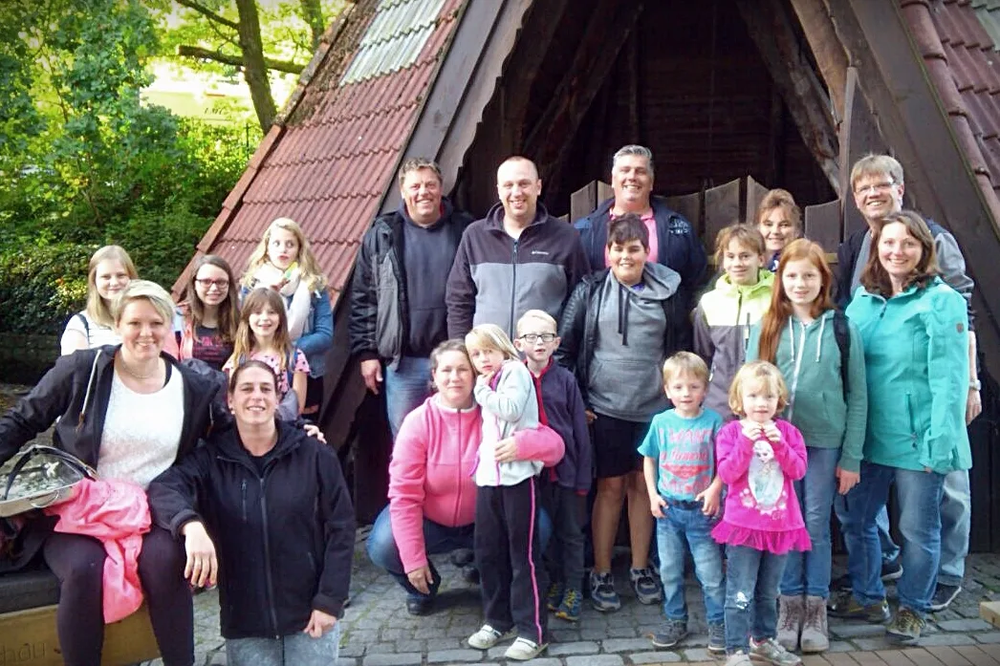

Es war ein wundervoller Tag! Sonntagmorgen trafen wir uns bei Kaiserwetter auf dem Kirchspiel-platz, beschnackten kurz das Nötige, regelten die kurzfristigen Anmel-dungen und dann ging es auch schon los nach Tolk. Zum Hintergrund: Die WGW -aktiv- zahlt aus dem Erlös des Tannenbaum-verkaufs die Grillhütte, sorgt für das leibliche Wohl und je nach Kassen-lage, das eine oder andere Bonbon.

 _( Foto: Ausflug_ __zur Tolk-Schau_ mit der WGW -aktiv-, zusammen mit Witzworter Familien_ _)_

Die Fahrt verlief reibungslos. Dann kurzes Anstehen und auf die Bollerwagen und die Handvoll Eintrittskarten warten und ab ging es in den Park um dann schnell die Grillhütte zu beziehen. Wir hatten in diesem Jahr eine große Hütte gemietet, damit wir auch bei Regen gemeinsam essen oder uns bei Regen unterstellen konnten. Mittags genossen wir dann das gemeinsame Grillen. Unterstellen war nicht von Nöten, denn wir hatten einfach ein fantastisches Wetter. Irgendwie hatten die Kinder keine Zeit, dass gemeinsame Grillen und Schnacken zu genießen… komisch. Stattdessen hatten sie alles an Spielgeräten ausprobiert, was dort stand.

Das Schöne an der Tolk-Schau ist, dass dort immer mal wieder unauffällig etwas Neues entstanden ist, was es zu entdecken galt. Absolut lustig waren die durch die Dino-Statuen laufenden Hühner. Das müssen also die „Hühno-Saurus“ gewesen sein! Der Kaffee zum Beispiel war dort für eine Pause zwischendurch auch zu erschwinglichen Preisen zu erstehen. Da machte es dann auch Spaß, sich mal hinzusetzen und einfach mal zu entspannen.

Was früher Elke und Klaus, Lena und Kuddel und unser Bürgermeister, Willi Berendt, jedes Jahr von der WGW - aktiv- für die Bürger Witzworts angeboten haben, wird nun von der nächsten Generation weitergeführt. Ein gemütlicher Tag, gemeinsam und mit viel Spaß an der Sache. Veranstaltet wird die Fahrt zur Tolk-Schau jedes Jahr aufs Neue, unterstützt aus den Erlösen des Tannenbaumverkaufs am 3. Advent eines jeden Jahres. Und das soll auch bitte so bleiben!

Wenn die Kids zum Abschied schon sagen, dass sie sich auf nächstes Jahr freuen, dann haben wir alle zusammen alles richtiggemacht. Dafür ist es einfach zu schön, diesen Tag gemeinsam zu erleben. Wie die Kids sich gegenseitig helfen, wie alle an einem Strang ziehen und gemeinsam Spaß haben. Wie es endet, wenn am Ende gegen 17:30 Uhr die Männer nochmal mit dem Boot von der Rampe ins Wasser springen und dabei lauter lachen als die Kids. Einfach wunderschön! Vielen Dank an alle, die mitgekommen sind und diesen Tag zu dem gemacht haben, was er war und uns in toller Erinnerung bleiben wird:

EIN WUNDERSCHÖNER TAG - DANKE SCHÖN!

**WGW - Der Verein**
