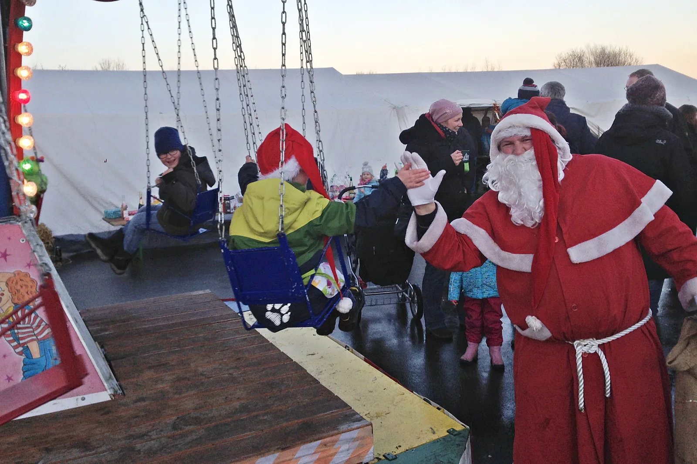
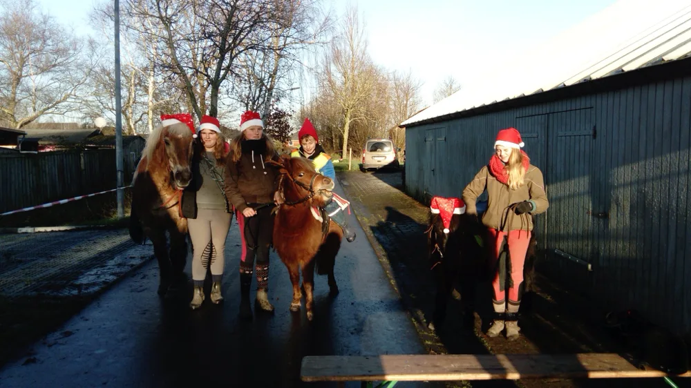
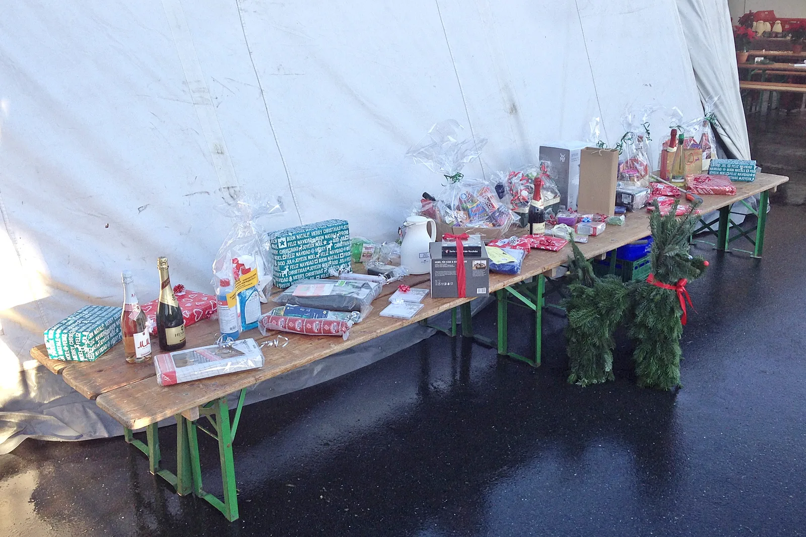

_Ein Kommentar von Bärbel Ingwersen_

Angefangen hatte alles vor 38 Jahren, mit einem ganz normalen Tannenbaum-verkauf, kurz vor Weihnachten. Die Idee: Erleichterung des Kaufes der damals doch weiten Wege und ein unkomplizier-tes Zusammenkommen der Dorfgemein-schaft, um einfach mal wieder gemeinsam zu schnacken und in gemütlicher Runde einen Glühwein zu trinken. Heute, wo die Tannenbäume an jeder Ecke zu kaufen sind - „als wenn sie auf Bäumen wachsen würden“ - ist der Weihnachtsmarkt Witzwort, der von der Wählergemeinschaft Witzwort ( WGW ) am jeweils 3. Advent organisiert und durchgeführt wird, doch zu etwas mehr geworden, als nur der einfache Verkauf von Weihnachtsbäumen. Zugegeben: Wir hatten an diesem Tag optimales Wetter! Der Posaunenchor Witzwort, unter der Leitung von Reiner Bernhardt, gab traditionsmäßig ihr Können als Startsignal. Die Witzworter Musikgruppe „Hava Nagila“ übernahm die musikalische Untermalung und ein kleines Karussell stand für die Kleinsten unseres Dorfes bereit. Ponyreiten wurde angeboten und hungrig und durstig sollte auch niemand vom Platz gehen. 

Doch das sollte nur der eine Grund gewesen sein, warum der Adventsnachmittag eine schöne Veranstaltung werden sollte. Der andere war relativ einfach auf den Punkt zu bringen: Es herrschte einfach eine schöne Stimmung auf dem Platz und man stand oder saß zusammen, um mal wieder gemeinsam etwas Zeit zu verbringen.

  

Auch wenn wir als Wählergemeinschaft Witzwort diesen Weihnachtsmarkt organisieren, ist der Nachmittag für uns ein Angebot an das Dorf, um das Leben in Witzwort zu bereichern und keinesfalls eine „Werbeveranstaltung“ für unsere Wählergemeinschaft. Mal ehrlich: Wenn wir es nicht tun, wer macht es dann? Zukünftig ist jeder herzlich eingeladen, mit seinen Ideen oder mit seiner Unterstützung, den 3. Advent für uns alle noch interessanter zu machen. Oder kommen Sie doch einfach vorbei, um bei einem netten Gespräch einen Glühwein oder Punsch zu genießen.

Zu erwähnen bleibt, dass die Einnahmen aus den Verkäufen des Weihnachtsmarktes in diverse Vorhaben unseres Dorfes zurückgehen und nicht, wie vielleicht angenommen, in die Kasse der WGW übergeht. Den besonders aufmerksamen Lesern unter Ihnen wird vielleicht aufgefallen sein, wie oft und wie viel die WGW für Projekte und Vorhaben spendet.

Der Weihnachtsmarkt 2017 endete mit der Lotterie und einem gewiss verärgerten Losbesitzer mit der Nummer „075“, welcher sich nach Aufruf nicht meldete, als er ein Wochenende mit einem Auto seiner Wahl gewann. So wurde die nächste Nummer aufgerufen, dessen Besitzer dann schließlich diesen tollen Gewinn mit nach Hause nehmen durfte. Es lohnt sich also immer, bis zum Schluss zu bleiben. Das tat der Nikolaus auch, der den Weihnachtsmarkt mit seiner Anwesenheit erfreut hatte und sich noch ein paar Gedichte vortragen ließ, „High-Five“ mit den Kindern am Karussell machte und selbst sichtlich die Stimmung genoss.

Die Wählergemeinschaft Witzwort bedankt sich bei allen Spendern und Sponsoren für unsere Tombola, bei allen Helfern, beim Posaunenchor Witzwort für die jahrelange Begleitung und nicht zuletzt bei allen glücklichen Besuchern für diesen schönen Tag! Die WGW wünscht Ihnen Glück, Gesundheit und einen ruhigen Jahreswechsel. Wir sind natürlich auch 2018 für Sie da – gemeinsam für Witzwort.

**Bärbel Ingwersen**

1\. Vorsitzende WGW
