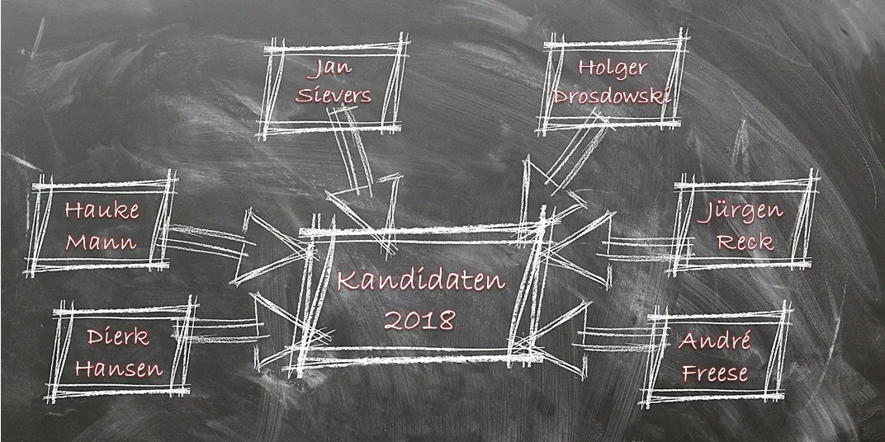
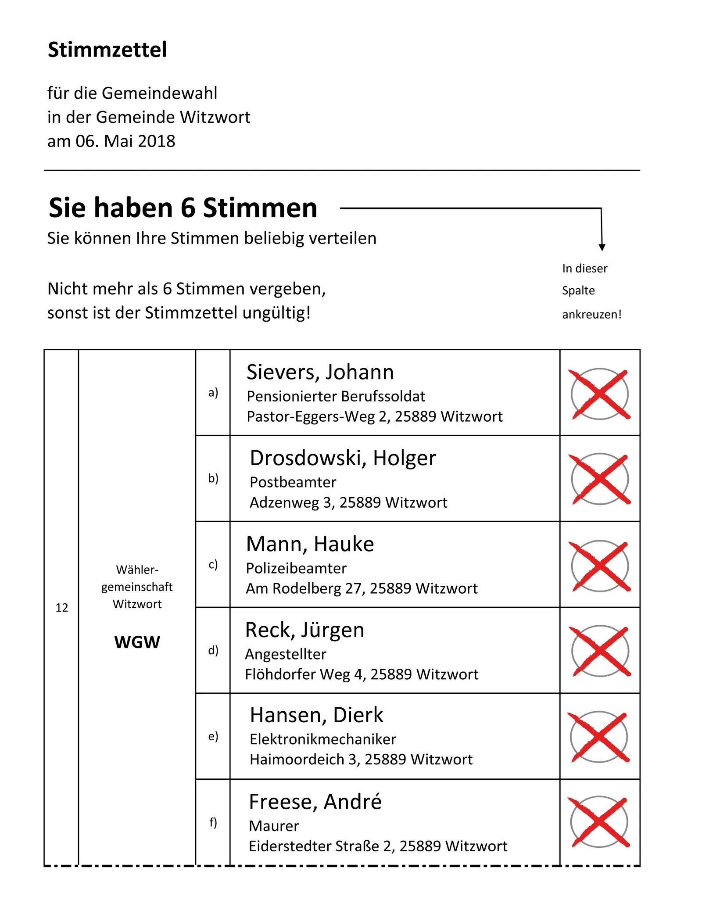

**UNSER ANLIEGEN**

Am 06. Mai 2018 ist Kommunalwahl. Hierbei haben die Witzworter Bürgerinnen und Bürger die Möglichkeit, die zukünftigen Gemeindevertreter unseres Dorfes zu wählen. Die gewählten Gemeindevertreter entscheiden dann, für die Dauer von fünf Jahren, zusammen mit dem neuen Bürgermeister, über die politischen Geschehnisse in unserer Gemeinde.

Bereits am 07. Februar 2018 kam die WGW zusammen, um darüber abzustimmen, welche ihrer Mitglieder die Wählerinnen und Wähler am 06. Mai zur Wahl haben. Heraus kamen sechs Kandidaten, die stellvertretend für die WGW als Gemeindevertreter im Mai zur Wahl stehen

( siehe Muster-Stimmzettel ).  

Damit Sie sich bereits vor der Wahl einen Eindruck von unseren Kandidaten machen können, möchten wir Ihnen unsere Kandidaten genauer vorstellen.

Hierzu erhalten Sie **ab dem 04. März** Gelegenheit, sich hier wöchentlich – immer an einem Sonntag - über einen weiteren unserer Kandidaten in Form eines Portraits zu informieren. Nach Ablauf von 6 Wochen werden Sie sich dann hoffentlich von jedem unserer Kandidaten ein Bild gemacht haben können. Starten werden wir mit der Vorstellung unseres Bürgermeisterkandidaten Jan Sievers.  

**Nur dann, wenn es der WGW gelingt, alle diese sechs Kandidaten in den Gemeinderat zu bringen, erhält die WGW auch die Möglichkeit, den Bürgermeister zu wählen, unseren Bürgermeisterkandidaten Jan Sievers!**

Zudem wird immer mal wieder interessiert nachgefragt, was eigentlich wäre, wenn die WGW zur anstehenden Kommunalwahl am 06. Mai so viele Stimmen erhalten würde, das sie mehr als nur 6 Vertreter stellen könnte. Ganz einfach: Dann würden die zusätzlichen Stimmen auf die weiteren Listenplätze verteilt werden.

Oft schließt sich dann die Frage an, ob wir denn auch die verbleibenden 5 Listenplätze auffüllen könnten. Schließlich würde der Gemeinderat ja aus 11 Gemeindevertretern bestehen. Die Antwort: Natürlich! Wie bereits bei den vergangenen Kommunalwahlen, kann die WGW auch dieses Jahr wieder aus den Vollen schöpfen und hätte im Falle eines Falles 5 weitere Kandidaten in petto.

Hier die Übersicht der Listenplätze 7 bis 11:

-   Platz 7:  Michael Nymand

-   Platz 8:  Gerd Radke

-   Platz 9:  Rolf Matthiesen

-   Platz 10:  Wolfgang Kruse

-   Platz 11:  Bärbel Ingwersen
