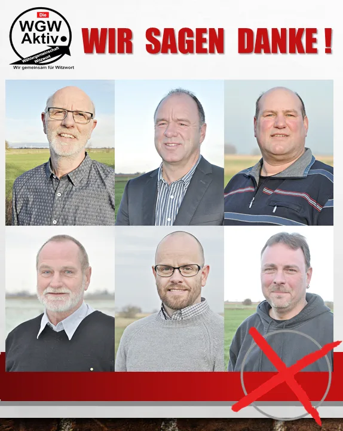
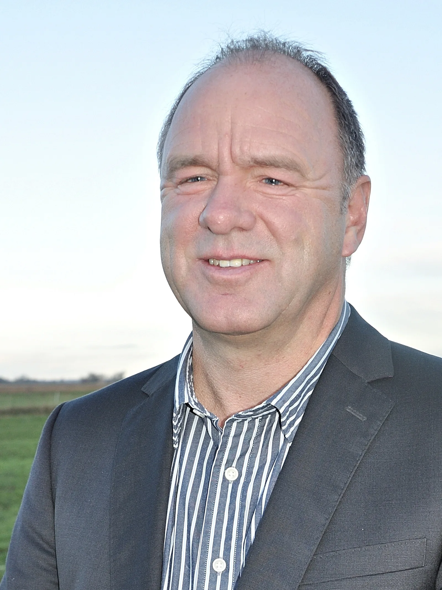

**WIR SAGEN DANKE**

Eine spannende Wahlkampfzeit mit vielen interessanten Begegnungen liegt hinter uns. Wir möchten uns ganz herzlich bei all unseren Wählerinnen, Wählern und Unterstützer für das entgegengebrachte Vertrauen bedanken. Mit Hilfe Eurer/Ihrer Stimme ist es uns gemeinsam gelungen, alle unsere 6 Kandidaten, sicher und in überwältigender Stimmenanzahl, in den neuen Gemeinderat zu platzieren.

Wir haben im vergangenen halben Jahr viele neue Mitstreiter dazugewinnen können. Dieser Wahlkampf hat uns alle zusammengeschweißt und gezeigt, dass wir ein Team sind. Allen Helfern und Mitgliedern der WGW ein aufrichtiges Dankeschön für das Engagement und den vielen Gesprächen mit den Bürgerinnen und Bürgern in unserer Gemeinde.

Wir wollen uns nun nicht auf unserem jetzigen Erfolg ausruhen, sondern nach wie vor ein offenes Ohr für Sorgen, Nöte und Probleme in unserer Gemeinde haben, um gemeinsam auszuloten, was davon lösbar oder politisch durchzusetzen ist. Wir benötigen Eure/Ihre Unterstützung, damit wir uns auch zukünftig gemeinsam für unsere Gemeinde stark machen können. Wir freuen uns auf das Gespräch mit Euch/Ihnen!

  

Am 06.05.2018 wurden die Gemeindevertreter unserer Gemeinde gewählt. Die Wahlzeit der neu gewählten Gemeindevertretungen beginnt am 1. Juni 2018 und endet am 31. Mai 2023. Nachfolgend eine kleine Übersicht über Fakten und Ergebnisse dieser Wahl:

**Wahlberechtigte:** 847  
**Wählerinnen / Wähler:** 579  
**Wahlbeteiligung:** 68,4 %  
  
**WGW**  
Stimmen: 1.672  
Prozent: 52,0 %  
Sitze: 6  
  
**WOF**  
Stimmen: 891  
Prozent: 27,7 %  
Sitze: 3  
  
**CDU**  
Stimmen: 654  
Prozent: 20,3%  
Sitze: 2

**Der zukünftige Gemeinderat mit Stimmenanteil:**  
  
**WGW**  
Holger Drosdowski: 331  
Jan Sievers: 327  
Dierk Hansen: 268  
Jürgen Reck: 259  
Hauke Mann: 249  
André Freese: 238  
  
**WOF**  
Frank Rathje: 201  
Gabriele Lönne: 162  
Angela Jansen: 154  
  
**CDU**  
Jens Clausen: 109  
Uwe Hansen: 100

  

**Und für alle Statistiker unter uns, hier noch einmal die gesamten Zahlen - ganz offiziell:**

[http://www.amtnt.de/KW2018/Witzwort/wahl.html](http://www.amtnt.de/KW2018/Witzwort/wahl.html "http://www.amtnt.de/KW2018/Witzwort/wahl.html")

* * *

## Der Bürgermeisterkandidat der WGW 2018

**PORTRAIT JOHANN ( JAN ) SIEVERS**

**Ein Idealist mit Willen zum Gestalten**

Der Witzworter Jung gilt als Polit-Neuling. Johann Sievers stellt sich der Herausforderung und will sich jetzt noch mehr für sein Heimatdorf engagieren, um hierbei als junger und moderner Bürgermeisterkandidat seine Gemeinde zu repräsentieren.

Der 52-Jährige hat sich bisher nicht auf politischem Parkett bewegt, trifft gerne Entscheidungen und tritt als Kandidat der Wählergemeinschaft Witzwort an, um zukünftig Verantwortung für die Entwicklung der Gemeinde zu übernehmen. Aktiv und bürgernah.

Der pensionierte Berufssoldat ist in Witzwort zur Schule gegangen und hat sich seitdem fest in das aktive Dorfleben miteingebracht. So wundert es nicht, dass der als aufrichtig bekannte Jan Sievers innerhalb Witzworts, bei Jung und Alt bekannt ist.

Hierzu zählt neben seiner langjährigen Mitgliedschaft im Boßel- und im Tennisverein auch die aktive Beteiligung im Reiterverein Witzwort.  

  

In dem er nicht zuletzt über eine mehrjährige Erfahrung als Erster Vorsitzender verfügt. Ehrenamtliche Tätigkeiten innerhalb der Gemeinde, bei denen unser Bürgermeisterkandidat seine Führungsqualitäten bereits unter Beweis stellen konnte. Geradlinig und zum Wohle der Allgemeinheit.

„Warum ich mir das Bürgermeisteramt in der Gemeinde Witzwort vorstellen könnte? Es ist ganz einfach“, - lächelt der Vater eines 21-jährigen Sohnes - „weil ich total unvoreingenommen das Dorf für „alle“ Bürgerinnen und Bürger weiterhin attraktiv gestalten möchte.“ Hierbei setzt Jan Sievers auf respektvollen Umgang mit dem Bürger.

Seine politische Heimat hat der Bürgermeisteranwärter vor einem Jahr in der Wählergemeinschaft Witzwort gefunden. Hier kann er sich einbringen und gestalten – immer offen für was Neues. Innerhalb der WGW wird sein Stil als aufrichtig und vor allem uneigennützig beschrieben. Hierbei zeigt Jan Sievers seine Leidenschaft für die Sache – immer im Dialog mit dem Bürger. Die Ideale der Wählergemeinschaft, die durch unseren Kandidaten vertreten und weiterentwickelt werden.

**Die Fraktion der WGW**
