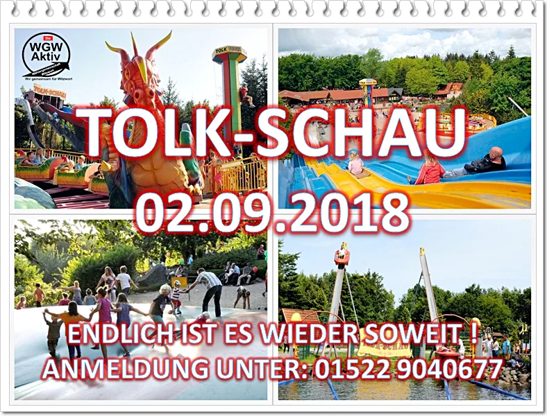

**TOLK-SCHAU 2018**

_**Endlich ist es wieder soweit –**_

_**es geht los!**_

Die WGW Aktiv möchte alle Witzworter, egal ob groß oder klein, am Sonntag, den **02.09.2018** recht herzlich zu unserem alljährlichen Ausflug zur TOLK-Schau einladen. Wie immer, sind nicht nur Mitglieder der WGW eingeladen, sondern alle Dorfbewohner.

Gemeinsam wollen wir im Freizeitpark Tolk viel Spaß haben und gemeinsam eine tolle Zeit verbringen.

Wie bereits in den vorangegangenen Jahren, haben wir auch diesmal eine Grillhütte gemietet und werden dort mittags den Grill anwerfen und zusammen essen.

Wir treffen uns um 09:00 Uhr beim Witzworter Kirchspielplatz. Von dort aus geht es dann gemeinsam los. Die Fahrtzeit beträgt ca. 1 Stunde. Die Rückfahrt in Richtung Heimat treten wir dann gegen 17.00 Uhr an.  
  
Die Kosten belaufen sich auf 18€ pro Person. Wir bitten um eine Salat-/Pizzabrot-Spende für das gemeinsame Buffet. Anmeldungen, Infos & Koordination der leckeren Mitbringsel bitte bis zum

**15\. August** über Katy Nymand: 01522 9040677.

WGW - Der Verein
