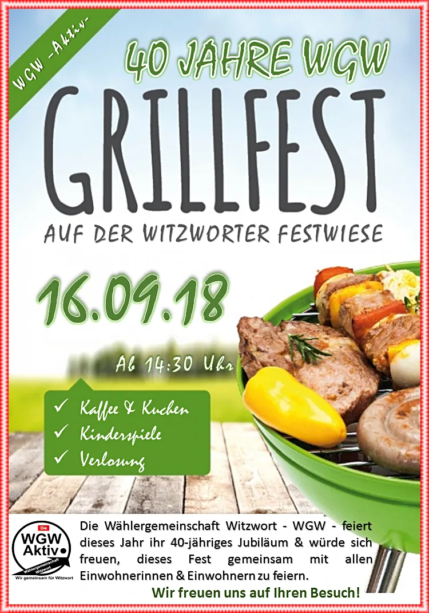

Die Wählergemeinschaft Witzwort blickt zurück auf ihre Gründung vor 40 Jahren. Was seinerzeit am 17.01.1978 mit dem Entschluss von unserem heutigen Ehrenbürgermeister, Willi Berendt, sowie 16 weiteren engagierten Mitbürgerinnen und Mitbürgern begann, sich gewissermaßen gemeinsam aktiv für unser Dorf einzusetzen, wird nun mehr seit über 40 Jahre erfolgreich fortgeführt.

Seit dieser Gründung ist viel geschehen in der WGW. So ist nicht nur die Mitgliederzahl in den vergangenen Jahrzehnten gestiegen, sondern auch die Bereitschaft, sich gemeinsam für- und miteinander für das Gemeinwohl einzusetzen.

Können doch die Mitglieder der Wählergemeinschaft auf viele Aktionen, Anlässe und Entscheidungen zurückschauen, die die Gemeinschaft gefestigt und das dörfliche Miteinander dauerhaft geprägt und gefestigt haben – unabhängig davon, ob die Idee und Antrieb hierzu nun aus dem Verein der WGW oder aus der Fraktion der WGW herrührte.

  

Diese gemeinsame Zeit nimmt die Wählergemeinschaft Witzwort zum Anlass sich aufrichtig bei all ihren Helfern und Mitgliedern für die erbrachte Zusammenarbeit zu bedanken. Hierzu feiern wir ein Grillfest und würden uns freuen, dieses Jubiläum gemeinsam mit allen Einwohnerinnen und Einwohnern Witzworts zu feiern.

Wir freuen uns auf ein tolles Fest und nette Gespräche!      

WGW - Der Verein
