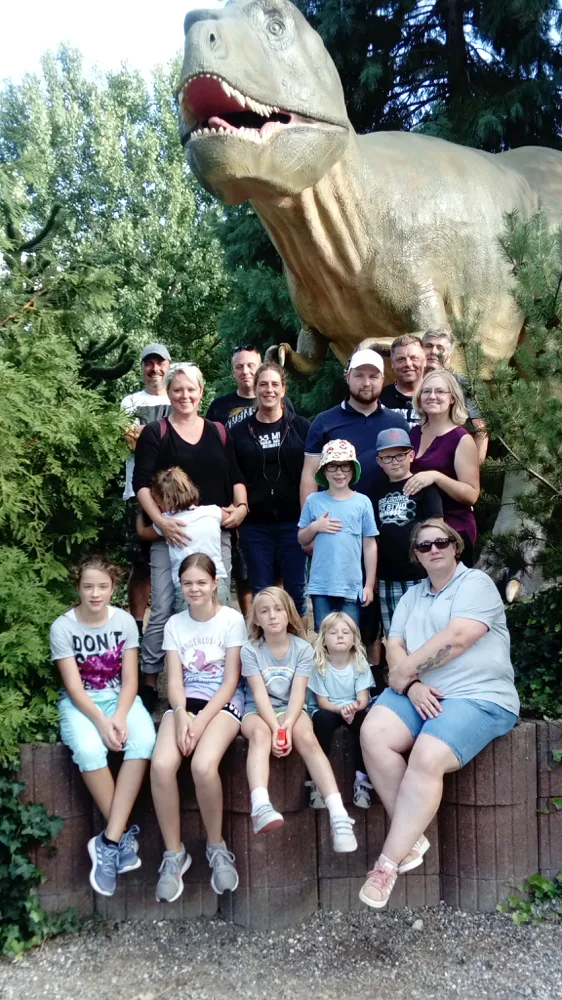

Der alljährliche Ausflug ins Familien-Spiele-Entspannungsparadies Tolk startete am Sonntagmorgen um 09:00 Uhr am Kirchspiel-platz in Witzwort. Kurzes Besprechen und Bezahlen des Eigenanteils und dann zog die Kolonne auch schon los in Richtung Tolk-Schau.

Da der Weg zum Ziel bekanntlich kurz ist, waren wir pünktlich, kurz nach dem Öffnen der Tore dort, um uns die Bollerwagen zu sichern und die bestellten Eintrittskarten abzuholen. Mit schwa-rem Gepäck ging es dann in Richtung der beiden Grillhütten, wo unser „Camp" eingerichtet wurde.

Die WGW -aktiv- zahlt jedes Jahr aus dem Erlös des Tannenbaumverkaufs die Grillhütten, das zugehörige Grillen, die Getränke, und je nach Kassenlage, das eine oder andere Bonbon.

Die teilnehmenden Familien hatten zuvor leckeren Salat und Pizzabrötchen zubereitet und mitgebracht, so dass um die Mittagszeit der Spielespaß für eine gemeinsame Mahlzeit kurz unterbrochen wurde.

  

Unsere allgegenwärtigen Freunde, die Wespen, waren an diesem Tag auch in Tolk und anscheinend sehr hungrig, woraufhin kurzfristig für die Kinder umgebaut wurde und die Kleinen in einer der Hütten in Ruhe essen konnten. Die Erwachsenen arrangierten sich eben mit den Nützlingen. Da wir ja nicht nur zum Essen in Tolk waren, sondern auch Spielen wollten, ging es nach der Pause wieder gestärkt in den Park. Unser „Camp" stand dann für Pausen und Getränke nachtanken zur Verfügung, bis es dann gegen 17:00 Uhr Richtung Ausgang ging.

Der jährliche Ausflug soll ein harmonischer Tag sein. Ohne Zwänge und mit viel Spaß am Gemeinsamen. Darum war es auch kein Problem, als eine Familie wegen akuter Übermüdung/Überspielung vorzeitig Richtung Kinderbettchen aufbrach. Das Pfand für die Bollerwagen wurde hin und her getauscht, bis jeder wieder seinen Ausweis hatte. Eine Familie litt noch an chronischer „Unterspielung" und musste noch ein Weilchen bleiben, bis auch das erfolgreich auskuriert war.

27 gutgelaunte Personen hatten schlussendlich den Tag in Tolk gemeinsam verbracht. Hierbei war es auch egal gewesen, ob es regnete oder - wie hier - die Sonne schien: Denn es war ein schöner Tag, der nach jahrzehntelanger Tradition, gemeinsam stattfand und auch bitte im nächsten Jahr wieder stattfinden soll.

An dieser Stelle erinnern wir gerne schon einmal an den anstehenden WGW-Tannenbaumverkauf am 3. Advent. Auch dieses Event der WGW bringt Spaß und gute Laune und was am Ende dabei herauskommt, haben wir auch dieses Jahr wieder in Tolk sehen und erleben dürfen. 

**WGW - Der Verein**
