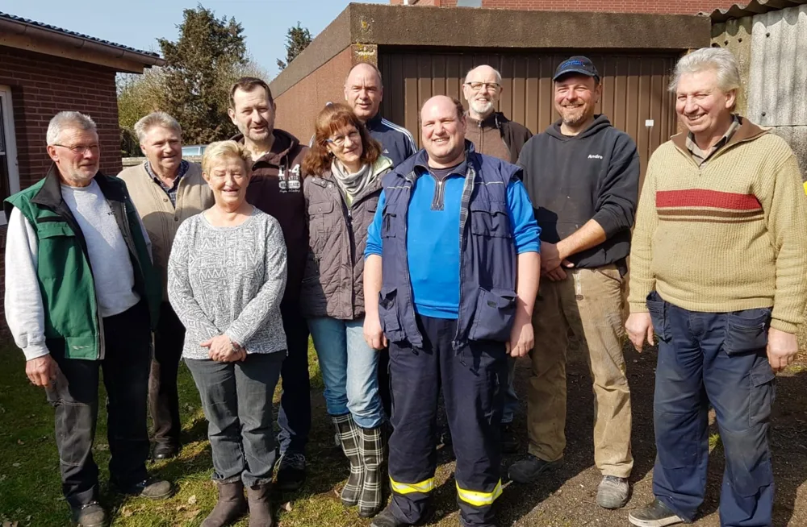

Es ist eine gute Tradition: Das Schietsammeln in Witzwort! So fand auch in diesem Jahr wieder der Frühjahrsputz in unserer Gemeinde statt. Bei frühlingshaftem Wetter trafen bereits um 09:00 Uhr 40  fleißige Helferlein auf dem Festplatz ein, um anschließend in kleinen Gruppen dem Unrat in unserem Dorf auf den Pelz zu rücken. Mit guter Laune konnte auch in diesem Jahr eingesammelt werden, was Viele, wie selbstverständlich, zuvor achtlos in die Natur geschmissen hatten. Neben jung und alt kamen auch in diesem Jahr wieder Mitglieder der WGW aus Verein und Fraktion zusammen, um beim Frühjahrsputz tatkräftig zu unterstützen ( siehe Foto ).

Nach dem Zusammentragen des Abfalls spendierte die Gemeinde, als Dank und Anerkennung für die vorbildliche Einstellung und Bereitschaft der engagierten Helferinnen und Helfer, einen kleinen Happen. So konnte bei einem kleinen "Schnack" Suppe, Würstchen und Getränken wieder Kraft aufgetankt werden. Der Ortskulturring hatte zudem unter den teilnehmenden Kindern und Jugendlichen zwei Kinogutscheine verlost. Vielen Dank an alle kleinen & großen Helferinnen und Helfer für ihre aktive Unterstützung, zum Wohl der Gemeinschaft, mit guten Beispiel voranzugehen!

**WGW - Der Verein**
