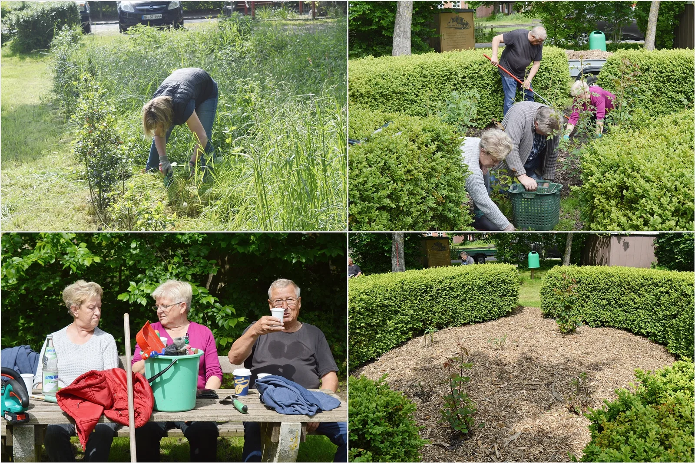

**am Witzworter Vereinsbaum**

Bereits am 01.06.2019 trafen sich Rolf und Ingrid Mathiesen, Kuddel, Lena und Sascha Thomsen sowie Sabine Feddersen am Vereinsbaum. Diese 7 aktiven Mitglieder der WGW hatten sich einiges vorgenommen: Man hatte festgestellt, dass die Anlage, rund um den Witzworter Vereinsbaum, in letzter Zeit ein wenig vernachlässigt wurde.

Nachdem die Herausforderung erkannt war und kurzerhand ein paar fleißige Helferlein aktiviert werden konnten, traf man sich mit hochgekrempelten Ärmeln und fachmännischem Gartengerät beim Vereinsbaum, mit dem Ziel, den Platz drum herum wieder auf Vordermann zu bringen. 

Kuddel, Lena und Ingrid rückten dem Unkraut im Buchsbaumrondell zu Leibe, währen Rolf und Sascha Schreddergut von der Kläranlage holten. Nachdem das Unkraut weg, die Rosen geschnitten, und von Ingrid eine gespendete Rose gepflanzt war, wurde das Schreddergut verteilt. Sabine nahm sich den völlig eingewachsenen Zaun am Graben vor. Die Sitzgruppe hatte Rolf schon im Vorfeld mit einem Hochdruckreiniger gereinigt, sodass nur das Unkraut darunter noch entfernt werden musste.

So verging ein schöner und sonniger Vormittag bei viel Spaß und guter Laune – gemeinsam für Witzwort!

**WGW - Der Verein**
