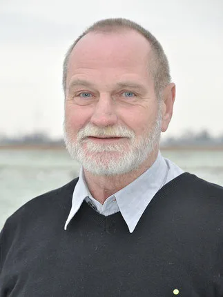
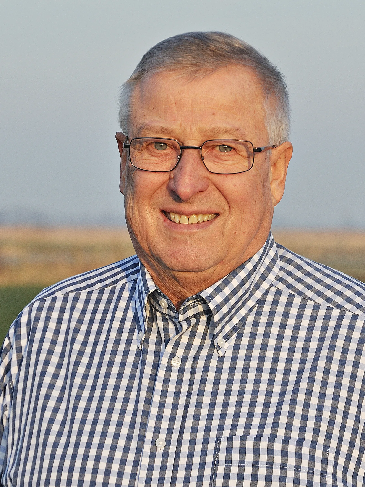

Am 03.06.2019 wurde im Rahmen der 4. öffentlichen Sitzung der Gemeindevertretung der Gemeinde Witzwort ein Wechsel innerhalb unserer Fraktion vollzogen. So bedankte sich Bürgermeister Sievers vorerst bei dem ausscheidenden Gemeindevertreter, **Jürgen Reck**, für seine jahrelange Tätigkeit als Gemeindevertreter und überreichte ein Präsent.

Jürgen Reck, der bereits seit 2004 Mitglied der WGW ist, richtete sein Tun und Engagement als Gemeindevertreter in der Zeit 2008 - 2019 zum Wohl der Gemeinschaft aus. In diesem Zeitraum wirkte Jürgen als Mitglied im Finanzausschuss und übernahm Verantwortung als Vorsitzender im Ausschuss Jahresrechnung der Gemeinde.

Jürgen und seine Frau verkauften in diesem Sommer ihr Haus in Witzwort und verlegten ihren Wohnsitz in das benachbarte Uelvesbüll. Die Wählergemeinschaft Witzwort wünscht Jürgen und seiner Frau für die Zukunft alles erdenklich Gute.

Im weiteren Verlauf der Sitzung verpflichtete Johann Sievers im Anschluss den neuen Gemeindevertreter der WGW, **Rolf Matthiesen**, durch Handschlag auf die gewissenhafte Erfüllung seiner Obliegenheiten und führte ihn in seine Tätigkeit als Gemeindevertreter ein.

Durch die Ausscheidung Jürgen Recks, wurde für folgende Ausschüsse,

Rolf Matthiesen, vorgeschlagen und einstimmig gewählt:

-   Finanzausschuss,
-   Ausschuss zur Prüfung der Jahresrechnung,
-   stellv. Vorsitz für den Amtsausschuss,
-   stellv. Vorsitz für den Schulverband Witzwort,
-   stellv. Vorsitz des Wasserbeschaffungsverband Eiderstedt.

Weiterhin schied der Gemeindevertreter, Dierk Hansen, aus dem Ausschuss für Kultur, Tourismus, Jugend, Sport und Soziales aus. Rolf wurde auch hier einstimmig vorgeschlagen und gewählt. Der Ausschuss-vorsitzende, Hauke Mann, bedankte sich bei Dierk für die gute Zusammenarbeit im Ausschuss und hieß Rolf als neuen Mitstreiter herzlich willkommen.

## Portrait - Rolf Matthiesen

#### Persönliches Profil

* * *

Schon 2006 kauften meine Frau und ich, ein Haus im Geschwister-Lorenzen-Weg in Witzwort, modernisierten es und zogen 2012 nach Witzwort.

Eine berufliche Herausforderung war es für mich, nach dem Studium, mit an dem Eider-Sperrwerk und im U-Bahnbau in Hannover und Hamburg, sowie am Elbe-Seitenkanal mitzuwirken.

Da wir jetzt Mitbürger sind, möchte ich weiterhin für die Wählergemeinschaft und der Gemeinde Witzwort tätig werden und mitgestalten, zum Wohle der Gemeinde.

**Alter/Familienstand:**

70 Jahre, verheiratet, 2 Kinder,

geb. in Elmshorn

**Interessen:**

Natur, Segeln, Angeln, Reisen

**Beruf:**

Rentner; zuvor selbstständiger Maurermeister,

danach 26 Jahre in Berlin beim Bundesbauamt

als Projektleiter/Bauingenieur
