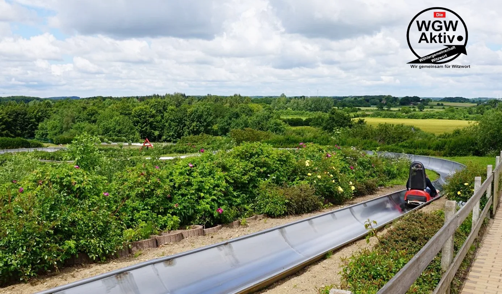

Unser alljährlicher Ausflug zur Tolk-Schau startete am 08. September wie gewohnt um 09:00 Uhr am Kirchspielplatz in Witzwort. Nach kurzem Klönschnack und Bezahlen des Eigenanteils, machten sich 17 kleine und große Spaß- und Spielbegeisterte in Richtung Tolk-Schau.

Pünktlich zur Öffnung des Parks konnten wir uns die ersten Bollerwagen sichern. Mit großer Vorfreude ging es anschließend gut gelaunt zu

unserer Grillhütte, die wir für den Tag einrichteten. Die WGW -Aktiv- zahlt jedes Jahr aus dem Erlös des Tannenbaumver-kaufs des Vorjahres die Grillhütten, das zugehörige Grillen und die Getränke. Auch in diesem Jahr hatten fleißige Eltern leckeren Salat und Beilagen im Gepäck, so dass um die Mittagszeit gemeinsam gegessen werden konnte. Nachdem wir uns gestärkt hatten, ging es zurück ins Spielevergnügen. Die Hütte stand für den Rest des Tages für Pausen und Getränke zur Verfügung.

Nach vielem Toben und kaputt vom Tag, machten wir uns dann um 17:00 Uhr mit einem Lächeln im Gesicht auf den Rückweg zurück nach Witzwort. So endete ein harmonischer Tag, ohne Zwänge und mit viel Spaß am Gemeinsamen, welcher nach jahrzehntelanger Tradition, gemeinsam stattfand und natürlich auch im nächsten Jahr wieder stattfinden wird. Und nicht vergessen: In diesem Jahr findet der 40. Weihnachtsmarkt der WGW statt – wie gehabt am 3. Advent. Auch diese Veranstaltung der WGW bringt immer viel Spaß und gute Laune und was am Ende dabei herauskommt, durften wir auch dieses Jahr wieder in Tolk sehen und erleben.

 **WGW – Der Verein**
