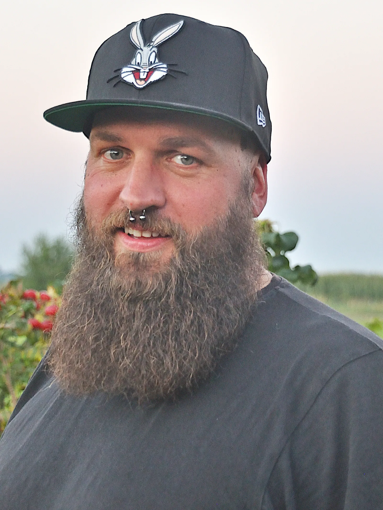

### Daniel Mittag

* * *

**Vereinsvorstand WGW:**

**2\. Vereinsvorsitzender**

Seit 2016 Mitglied in der WGW

Tel.: 0172 17 71 231  

#### Persönliches Profil

* * *

**Alter/Familienstand:**

40 Jahre, verheiratet, 2 Kinder

**Interessen:**

**Musik, Freunde und Familie**

**Beruf:**

**Erzieher**

  

Hallo Witzwort,

auch ich möchte mich und meine Beweggründe hier vorstellen und aufzeigen, warum es mir, als ein in Witzwort aufgewachsener "Jung vom Dorf" wichtig ist, aktiv und konstruktiv in der Wählergemeinschaft Witzwort mitzuwirken. In einer Zeit, in der uns immer weniger Zeit für das eigene Seelenwohl zur Verfügung steht, gestaltet sich das unterstützende und gemeinschaftliche Leben außerhalb der eigenen Familie als sehr schwierig. Die Gesellschaft rückt stetig weiter auseinander und eine Tendenz zur sogenannten "Ellenbogengesellschaft" ist leider überall immer deutlicher spürbar. Wir wollen das nicht!

Wir wollen es uns zur Aufgabe machen, zusammenzurücken und Dorfleben zum Leben zu erwecken und selbiges auch zu leben. Weitab der Anonymität der Städte. Wir wollen das unsere Kinder lernen und sehen wie wir miteinander respektvoll und wertschätzend umgehen. Wie wir uns gegenseitig unterstützen und füreinander einstehen. Wir müssen das Rad nicht neu erfinden denn unsere Eltern und Großeltern haben uns aufgezeigt, wie und vor allem das es funktionieren kann.

Der Verein WGW möchte genau daran ihren Teil beitragen, indem wir miteinander sprechen, uns zuhören und uns ein Bild von unserem Dorf sowie den Interessen und Bedürfnissen der Einwohner machen, um dann zielorientierte Ideen entwickeln zu können. Dazu bedarf es Euch. Je mehr Mitglieder mit und an der WGW teilhaben, desto größer die Chance Dorfleben zu verwirklichen und zu leben. Unabhängig vom politischen Geschehen unserer Gemeinde, geht es um Gemeinschaft, persönlichen Kontakt und Hand in Hand für unsere Kinder, unseren Nachbarn und unser Dorf.

Ich freue mich auf nette Gespräche, Anregungen und über jedes neue Mitglied zur Unterstützung unseres Vorhabens.

Besten Gruß, wir schnacken!
