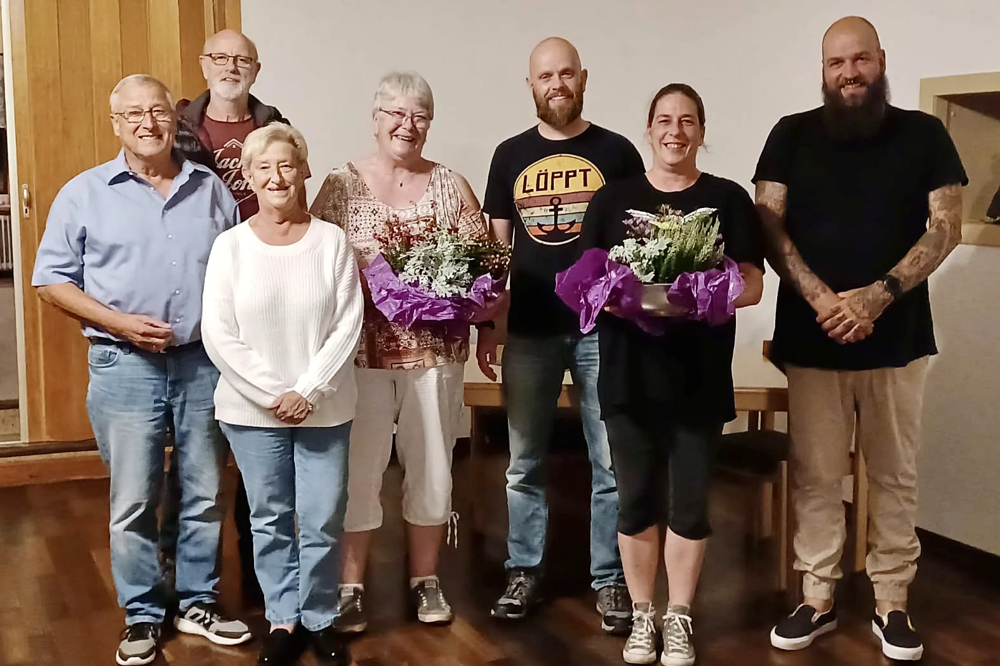

**Vorstandswechsel beim Verein der WGW: Hauke Mann und Daniel Mittag wollen den Verein der Wählergemeinschaft mit frischem Wind vorantreiben**

Die 47 Vereinsmitglieder der WGW haben einen neuen Vorsitz. Genauer gesagt, zwei: Hauke Mann und Daniel Mittag verantworten nun die Belange und Aktivitäten des Vereins der WGW. In der Jahreshauptversammlung der Vereinsmitglieder, am 09.09.2021 im Witzworter Dörpshuus, wurden die beiden Vorsitzenden in ihrem neuen Amt bestätigt.

Mit der neuen Doppelspitze ist zugleich ein Team aus zwei zuvor bekannten Mitgliedern angetreten, das den bereits durch den ehemaligen Öffentlichkeitsbeauftragten, Hauke Mann, eingeschlagenen Kurs, das Zusammenrücken der Dorfgemeinschaft und die Schaffung einer neuen Mitgliederkultur, vorantreiben will.

Die bisherige 1. Vereinsvorsitzende, Bärbel Ingwersen war aus gesundheitlichen sowie zeitlichen Gründen nicht mehr angetreten. Bärbel, die bereits seit 2004 die Aktivitäten als Mitglied des Vereins begleitete, hatte in den letzten 9 Jahren das Amt der Vereinsvorsitzenden übernommen. _„Nach fast einem Jahrzehnt spannender Arbeit für und mit der WGW, ist es nun an der Zeit, gerade auch den jüngeren Mitgliedern unter uns die Möglichkeit zu geben, ihre Visionen für das Dorf aktiv umzusetzen“._ Dem Verein möchte sie weiterhin eng verbunden bleiben und wird daher weiterhin bei Vereinsaktivitäten mit dabei sein.

Ihre Position nimmt nun Hauke Mann ein, der als 1. Vereinsvorsitzende gewählt wurde und bisher seit 3 Jahren als Vorstandsmitglied im Bereich der Öffentlichkeitsarbeit tätig war. Hierbei war er u.a. für den Internetauftritt und im Bereich Sozial Media zuständig. Hauke, der bereits seit 2017 dem Verein angehört, freut sich nun auf seine neuen Aufgaben als Vorsitzender. _„Daniel und ich sind voller Tatendrang und freuen uns sehr, jetzt die Ärmel hochzukrempeln und die vor uns liegende Arbeit und Ziele des Vereins - zusammen mit unseren Mitgliedern - anzugehen und umzusetzen“._

Daniel Mittag, der ab sofort in Verantwortung des 2. Vereinsvorsitzenden steht, gehört dem Verein der WGW bereits seit 5 Jahren an. _„__Hauke und ich wollen es uns zur Aufgabe machen, dass die Dorfgemeinschaft mehr zusammenrückt, um das Dorfleben mit Leben zu erwecken und selbiges auch zu leben. Weitab der Anonymität der Städte. Wir wünschen uns, dass unsere Kinder lernen und sehen, wie wir miteinander respektvoll und wertschätzend umgehen. Wie wir uns gegenseitig unterstützen und füreinander einstehen. Wir müssen das Rad nicht neu erfinden, denn unsere Eltern und Großeltern haben uns aufgezeigt, wie und vor allem das es funktionieren kann!“_

Daniel nimmt somit die Position der scheidenden 2. Vorsitzenden, Katy Nymand, ein. Katy, die bereits seit 2001 Mitglied des Vereins ist, übernahm seit 2017 als 2. Vorsitz Verantwortung im Vorstand und hatte sich, insbesondere durch das Forcieren der Kinder- und Jugendarbeit innerhalb unseres Dorfes, aktiv in den Verein eingebracht. Hauke Mann bedankte sich beim alten Vorsitz für die geleisteten Jahre und hob noch einmal das Engagement beider Frauen hervor _„In Würdigung Eurer Treue und verdienstvollen Tätigkeit in Eurer Funktion als Vereinsvorsitz, bedanken sich die Mitglieder der WGW für die geleistete Arbeit und wünschen Euch und Euren Familien alles Gute!“_

Holger Drosdowski feiert in diesem Jahr sein 40-jähriges Vereinsjubiläum. Hauke überreichte ihm hierzu ein kleines Präsent und bedankte sich bei ihm für seine Verpflichtung gegenüber dem Verein und seinem Wirken in der Fraktion.

**WGW - Der Vereinsvorstand**
