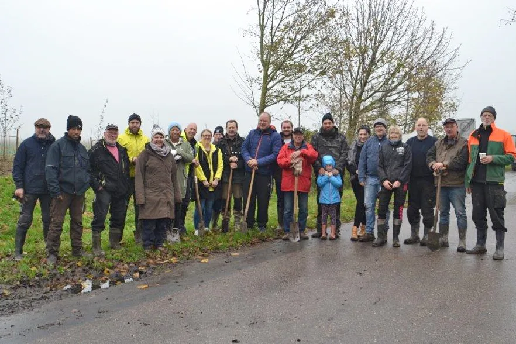

**Naturschutz für jedermann: Mit großem Engagement und guter Laune**

Die Gemeinde Witzwort hatte für die Bepflanzung des Dreiecks Ohlfelder-/, Kirchen-/, u. Süderohlfelderweg, Bäume und Sträucher gekauft. Wo sonst ein Meer aus Sonnenblumen den Platz in eine leuchtend gelbe Oase für viele Insekten verwandelt hatte, sollten nun zukünftig auch 11 einheimische Apfelbäume, 1 Trauerweide, 1 Rotbuche, 20 ansässige Sträucher und insgesamt 100m Feldahorn einen festen Platz bekommen.

Ein tolles Vorhaben, bei dem der Verein WGW - treu nach seinem Motto: Wir gemeinsam für Witzwort - tatkräftig unterstützen wollte. So erhielten die Gemeindearbeiter am Samstag, 13. November, bei der Bepflanzung des Dreiecks aktiven Beistand: Neben 7 weiteren engagierten Dorfbewohnern, hatten sich um 09:30 Uhr insgesamt 20 Vereinsmitglieder der WGW, ausgestattet mit Gummistiefeln, Spaten und Schaufeln, am Dreieck eingetroffen, um nach kurzer Einweisung und voller Tatendrang, Löcher in dem schweren und durchnässten Boden auszuheben, Bäume und Sträucher einzusetzen, Pfosten einzurammen und zu vertäuen.

Aufgrund der großen Anzahl von Unterstützern war binnen zwei Stunden der letzte Strauch gepflanzt und alle hatten - so ganz nebenbei - mit einer Menge Spaß und Klönschnack in geselliger Runde, eine gute Tat für den Naturschutz begangen. Die Tierwelt, insbesondere die Insekten und damit auch die ganze sich daran anschließende biologische Kette, wird es uns allen danken. Aber auch der Mensch - sozusagen als letztes Glied dieser Kette - wird sich hier zur gegebenen Zeit über reife Früchte freuen können.

Viele Dank allen Helferinnen und Helfern für diese tatkräftige Unterstützung!

**WGW - Der Vorstand**
