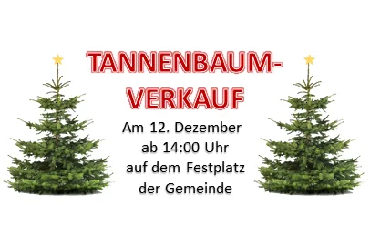

Viele von uns hatten sich bereits darauf gefreut: Gemeinsam mit Familie und Freunden endlich wieder einen Bummel über unseren Weihnachtsmarkt zu machen. Bei lockerem Klönschnack den Kindern beim Lachen & Toben zusehen und hierbei gemütlich eine heiße Wurst und einen leckeren Glühwein kosten - endlich wieder ein bisschen Normalität! Aber um jeden Preis? Geimpft oder nicht: Kinder in unserer Gemeinde haben sich am Virus angesteckt und in ein paar Kilometer Entfernung arbeiten Mediziner und Pflegekräfte bis zur Erschöpfung um Leben zu retten.

 Die Planungen stehen – alles fertig und in den Startlöchern!

Und dieses Jahr sollte es ein ganz besonderer Weihnachtsmarkt werden. Neben vielen schönen Sachen der letzten Jahre, haben sich neue tolle Dinge gefunden, mit denen wir Groß & Klein eine zusätzliche Freude bereiten wollten. Also, durchziehen? Das ginge nur unter Voraussetzungen, die uns seitens des Kreises auferlegt werden würden: 2G-Regelung, Maskenpflicht, Limitierung der Besucherzahlen, Hygienekonzept, einen Zugang mit strenger Einlasskontrolle durch den Veranstalter und Vorzeigen von Nachweisen und Ausweisen.

Der Vereinsvorstand hat hierzu eine klare Meinung: Wir kommen unserer Verantwortung nach. Ja, ein zweites Weihnachten ohne unseren Weihnachtsmarkt ist traurig, aber seien wir bitte alle ehrlich: Wie sollen die 2G-Regelung oder Abstand gewahrt werden? Wollen wir jedes Mal dazwischen, wenn man die Köpfe zusammensteckt und diskutieren, wenn jemand keinen Nachweis vorzeigt? Nein, das will wohl keiner von uns – müssten wir aber als Veranstalter. Jeden Tag sehen wir doch, wie einfache Regeln nicht eingehalten werden, die es aber erforderlich machen, gemeinsam durch diese schwere Zeit zu kommen: Leute tragen keine Maske, Abstand wird nicht eingehalten, und immer noch gibt es Menschen, die sich nicht impfen lassen wollen.

Das Motto unseres Vereins: „Wir gemeinsam für Witzwort!“ – ist aktueller denn je, denn gerade jetzt gilt es doch, solidarisch zu sein! Der Verzicht auf den Weihnachtsmarkt, ist unser aller Beitrag für die Gesundheit und zum Schutz unserer Kinder und unserer Alten. Dennoch haben wir uns auf vielfachem Wunsch, wenigstens die Weihnachtsbäume kaufen zu können, dazu durchgerungen, der Dorfgemeinschaft auch in diesem Jahr, Tannenbäumen zum Kauf anzubieten und laden hierzu am 12. Dezember ab 14:00 Uhr, auf dem Festplatz der Gemeinde und unter Beachtung der Hygieneregeln herzlich ein.

**WGW - Der Vereinsvorstand**
