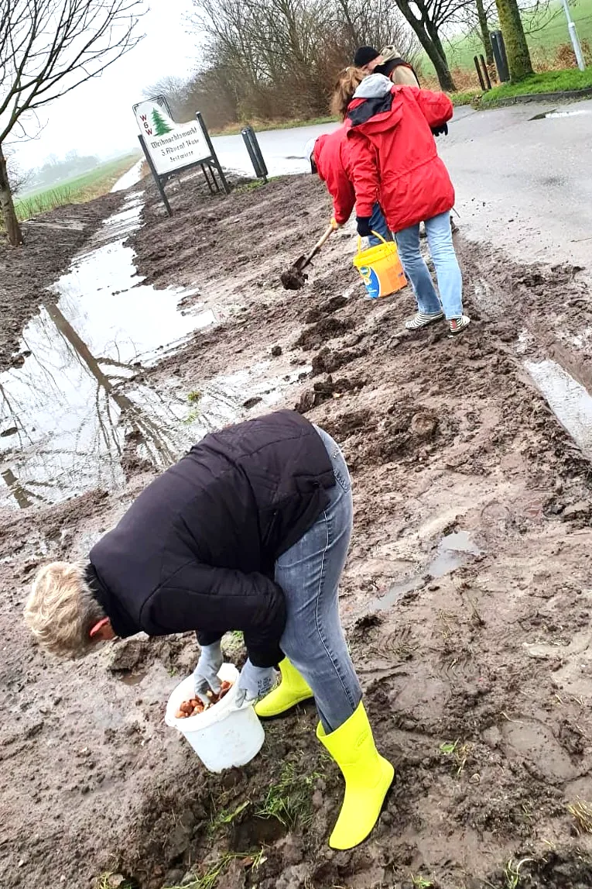
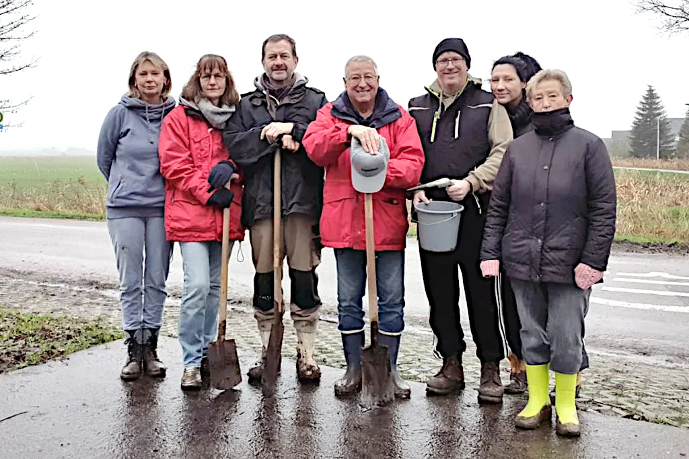

**Nach unserer Unterstützung der Gemeinde bei der Bepflanzung des Dreiecks Ohlfelderweg/Kirchenweg/Süderohlfelderweg, kamen nochmals Vereinsmitglieder der WGW am 04.12.21 zusammen, um unser Dorf noch etwas mehr zu verschönern.**

Zuvor hatte der Verein vom Hagebaumarkt in Husum – und das zu einem sehr günstigen Preis – insgesamt 600 Blumenzwiebeln, bestehend aus Tulpen, Narzissen und Krokusse erhalten, die jetzt in die Erde mussten.

So trafen sich vormittags 7 unserer Mitglieder, gut gelaunt und mit vollem Elan, um dieses Vorhaben in die Tat umzusetzen. Nach vorheriger Absprache mit den Gemeindearbeitern, hatten wir uns für dieses Jahr den Bereich des Dreiecks ausgesucht. In knapp 1 Stunde hatten wir vom Ortsschild bis zur Bushaltestelle, die 600 Zwiebeln eingepflanzt.  

Der Verein der WGW plant die gleiche Aktion auch im kommenden Jahr noch einmal, um auch noch weitere Flächen im Dorf zu verschönern. Zunächst bedanken wir uns bei allen fleißigen Helferinnen und Helfern und erfreuen uns im Frühjahr an dem hoffentlich farbenfrohen Ergebnis.

**WGW - Der Verein**

