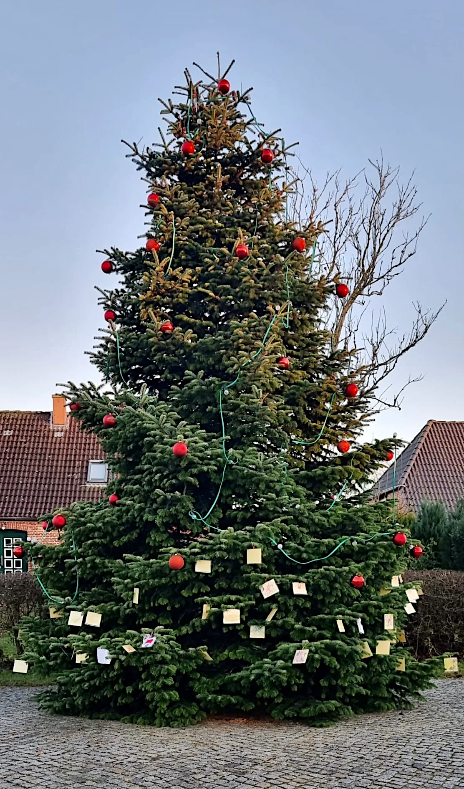

**Seit dem vergangenen Samstag ziert auf dem Witzworter Kirchspielplatz ein ganz besonderer Schmuck unseren eh schon stolzen und schönen Weihnachtsbaum. Wer sich die Zeit nimmt, hat nun die Möglichkeit, viele, toll aufgemalte Kinderwünsche an den Weihnachtsmann zu bewundern.**

Zuvor war die Wählergemeinschaft Witzwort mit ihrer neuen Idee - Kinderwünsche transparent zu machen - an die Ev. Kita Sonnenblume herangetreten. Hier stießen Groß und Klein sofort auf großes Interesse und die Kinder machten sich umgehend an die Arbeit.

Unter der Anleitung und Hilfestellung von Melanie Andres und ihrem Team, ging nun jedes Kind mit viel Spaß und größter Mühe darin über, seinen eigenen kleinen oder auch großen Wunsch an den Weihnachtsmann aufzumalen. So entstanden ganz nebenbei, viele kleine Kunstwerke, die im Anschluss von Mitgliedern der WGW aus der Kita abgeholt, einlaminiert und am Weihnachtsbaum aufgehängt wurden.  

Nach Rücksprache mit unserer Lütt-Dörp-School, zeigte sich auch dort der Schuldirektor, Herr Meier, von unserer Idee angetan und wird dieses Vorhaben in der nächsten Schulkonferenz vortragen, sodass ab dem nächsten Jahr - mit viel Glück, die Wünsche aller Kindergarten- und Schulkinder den Witzworter Weihnachtsbaum zieren werden.

Die WGW würde sich jedenfalls freuen, zukünftig nicht nur strahlende Kinderaugen derer erschaffen zu können, die ihr Weihnachtswunschbild im Weihnachtsbaum wiedererkennen, sondern würde sich auch wünschen, mit dieser jährlichen Aktion, auch bei den Erwachsenen, fortan ein Lächeln ins Gesicht zaubern zu können.

Die WGW wünscht allen ein frohes Weihnachtsfest, bitte bleibt gesund und passt auf Euch auf!

**WGW - Der Vereinsvorsitz**
