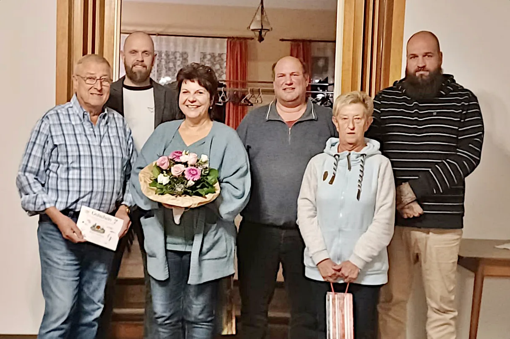

**Wahl einer neuen Kassenwartin, Vorstellung interessierter Vereins-mitglieder zur Kommunalwahl und das Angebot eines Weihnachts-marktes. 25 Vereinsmitglieder der Wählergemeinschaft Witzwort (WGW) folgten der Einladung zur Jahreshauptversammlung am 01. November in das Witzworter Dörpshuus.**  

(v.l.n.r.: R. Matthiesen, H. Mann, S. Sahlmann, D. Hansen, A.-L. Thomsen, D. Mittag)

Nach der Wahl des neuen Vereinsvorsitz im vergangenen Jahr, bei der Hauke Mann (1. Vorsitz) und Daniel Mittag (2. Vorsitz) die Verantwortung für den Verein übernahmen, stand auch in diesem Jahr wieder ein Wechsel innerhalb des Vorstandes sowie weitere wegweisende Veränderungen der Wählergemeinschaft an. Der 1. Vereinsvorsitzende erinnerte zu Beginn der Versammlung an die vor über 40 Jahren gegründete Wählergemeinschaft, dessen Witzworter Bürgerinnen und Bürger sich zur Aufgabe gemacht hatten, sich aktiv für ihr Dorf einzubringen. Seitdem sei die WGW fester Bestandteil der Gemeinde und habe sich hierbei in zwei Bereiche organisiert: den Verein und die Fraktion. Hauke Mann freute sich über den regen Zulauf 15 neuer Vereinsmitglieder seit der letzten JHV und berichtete darüber, dass zukünftig nun 62 Vereinsmitglieder der WGW, als Witzworter Bürgerinnen und Bürger, gemeinsam den dörflichen Charakter und den Zusammenhalt pflegen und hierbei gemeinsam für das Dorf einstehen würden.

Bei der turnusmäßigen Wahl des Kassenwartes übernahm Sonja Sahlmann, bereits nach knapp einem Jahr Vereinsmitgliedschaft, das Amt des scheidenden Kassenwartes, Rolf Matthiesen. Matthiesen, der bereits seit 2017 Mitglieds des Vereins ist, trat seit 2018 als Kassenwart und seit 2019 als Gemeindevertreter für die Belange des Vorstands und der Fraktion ein. Hauke Mann bedankte sich bei ihm für die geleisteten Jahre und hob noch einmal sein Engagement in der WGW hervor: _"Hinter jeder Person, die ehrenamtlich Verantwortung für andere übernimmt, steht auch ein starker Partner. In Anerkennung deiner Tätigkeit in der WGW, bedanken sich die Mitglieder für deine geleistete Arbeit und dem hierzu erforderlichen Rückhalt deiner lieben Frau und wünschen euch für eure Zukunft viel Gesundheit und alles Gute!"_ Matthiesen will dem Verein verbunden bleiben und das Dorf auch weieterhin gerne bei Vereinsaktivitäten unterstützen.

Dann wurde es spannend: Unter dem Tagesordnungspunkt „Vorstellung interessierter Vereinsmitglieder zur Kommunalwahl“ erhielt nun jedes Vereinsmitglied die Möglichkeit, ihren/seinen Wunsch, an der neu zu wählenden Fraktion der WGW mitzuwirken, zu äußern und sich hierzu entsprechend kurz vorzustellen. Anlässlich der anstehenden Kommunalwahl am 14. Mai 2023, hatten Rolf Matthiesen und André Freese, als zwei der insgesamt sechs bisherigen Fraktionsmitgliedern, bereits im Vorfeld angekündigt, dem Gemeinderat zur nächsten Legislaturperiode nicht mehr zur Verfügung zu stehen.

Nachdem die verbliebenen vier Fraktionsmitglieder, Jan Sievers (Bürgermeister), Holger Drosdowski (Bauausschussvorsitzender), Hauke Mann (Sozialausschussvorsitzender) und Dierk Hansen, der Versammlung ihre Bereitschaft zur Wiederwahl angeboten hatten, nutzten nun auch sechs weitere Vereinsmitglieder die Möglichkeit, ihre Person und Motivation, zukünftig gemeinsam für alle Einwohner Witzworts Verantwortung zu übernehmen, vorzustellen.   Neben den Vereinsmitgliedern Ariane Hennings, Gothia Rohwedder und Doris Eggenstein, gaben auch Uwe Röckendorf, Andreas Löbbecke und Stefan Nöhring bekannt, sich für die kommunalpolitische Arbeit innerhalb der WGW Fraktion, gemeinsam für die Geschicke Witzworts einzusetzen und hierbei, zusammen mit der erneut anzutretenden Fraktion, aktiv mitzugestalten.

Der Vorsitzende gab daraufhin bekannt, dass im Rahmen der Mitgliederversammlung der WGW im Frühjahr 2023, die hierzu vorgestellten Vereinsmitglieder auf die 11 Listenplätze der zukünftigen Fraktion gewählt und anschließend gemeinsam zur Kommunalwahl antreten würden. Bereits seit 1986 erhielte die WGW Fraktion hierfür vom Wähler den Auftrag. So stünden die politischen Vertreter der Wählergemeinschaft Witzwort seitdem ohne Unterbrechung mit ihrem Bürgermeisterkandidaten und gewählten Vertretern im Gemeinderat als politische Mehrheit in Verantwortung.

Der Vorstand informierte seine Mitglieder im weiteren Verlauf der Versammlung darüber, dass die WGW, nach 2-jähriger, Corona-bedingten Zwangspause, den Weihnachtsmarkt in diesem Jahr durchführen werde und traf hiermit bei den Mitgliedern auf großen Zuspruch. Dem Motto der WGW entsprechend: „Wir gemeinsam für Witzwort!“, hatte der Vorstand bereits 2020 entschieden, aufgrund der pandemiebedingten Herausforderungen, gemeinsam füreinander Verantwortung zu übernehmen und sich solidarisch zu zeigen. Der Verzicht auf den Weihnachtsmarkt, sei als Beitrag für die Gesundheit und dem Schutz aller Witzworter zu verstehen gewesen.

Die Planungen für den diesjährigen Weihnachtsmarkt würden stehen, alles sei fertig und stände bereits in den Startlöchern. Dieses Jahr solle es am 3. Advent ein ganz besonderer Weihnachtsmarkt werden, so der Vorstand. Neben vielen schönen und etablierten Sachen der letzten Jahre, wie z.B. der Tannenbaumverkauf, würden neue tolle Dinge hinzukommen, mit denen der Verein, Groß & Klein eine zusätzliche Freude bereiten wolle. Zudem werde der Verein im kommenden Jahr auch wieder die gewohnten Vereinsaktivitäten wie z.B. den Ausflug zur Tolk-Schau und das gemeinsame Dorfgrillen anbieten. Zwei von mehreren Angeboten für alle Witzworter, egal ob sie der WGW angehören oder nicht.

Die anwesenden Vereinsmitglieder Anne-Lene Thomsen und Dierk Hansen feierten in diesem Jahr ihr 40-jähriges bzw. sein 30-jähriges Vereinsjubiläum. Der Vereinsvorsitzende überreichte den Jubilaren ein kleines Präsent und bedankte sich für deren Verpflichtung gegenüber dem Verein sowie der hervorragenden Zusammenarbeit  und dem jahrelangen Wirken (1996) Thomsens als Schriftwartin im Vereinsvorstand.

Weitere Jubilare 2021 und 2022: Thea Lamp (40), Holger Drosdowski (40), Wolfgang Mittag (30), Detlev Stemberg (30) und Katy Nymand (20).

**WGW - Der Vereinsvorsitz**
