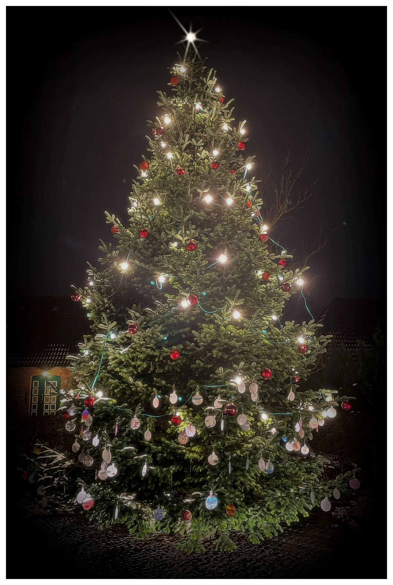

**Bereits seit dem 06. Dezember schmückt auf dem Witzworter Kirchspielplatz ein ganz besonderer Tannenbaumschmuck unseren traumhaften Weihnachtsbaum. Nimmt man sich die Zeit und tritt ein Stück näher, erkennt man allerlei Tannenbaumkugeln.**

Schon zum 2. Mal war die Wählergemeinschaft Witzwort mit ihrer 2021 gestarteten Idee - Kinderwünsche transparent zu machen - an die Ev. Kita Sonnenblume  und zum 1. Mal auch an die Lütt Dörp School herangetreten. Und auch in diesem Jahr stießen wieder Groß und Klein auf große Begeisterung, denn die Witzworter Kindergarten- und Schulkinder gingen sodann fleißig ans Werk.  

Mit Unterstützung von Erziehern und Lehrern, erfreute sich ein jedes Kind, mit viel Fantasie und größter Mühe, den eigenen kleinen oder auch großen Wunsch auf die vorgefertigten Weihnachtskugeln aufzumalen und zu schreiben. Heraus kamen viele kleine Kunstwerke, die im Anschluss von Mitgliedern der WGW abgeholt, einlaminiert und am Weihnachtsbaum auf dem Kirchspielplatz aufgehängt wurden.  

Die WGW freut sich riesig, mit ihrer Idee strahlende Kinderaugen zum Leuchten zu bringen, sobald sie ihre Weihnachtskugel im Weihnachtsbaum wiedererkennen und hofft, mit dieser Aktion, auch bei den Erwachsenen, ein Lächeln auf die Lippen zaubern zu können.

Die WGW wünscht allen eine besinnliche Weihnachtszeit!  

**WGW - Der Verein**
