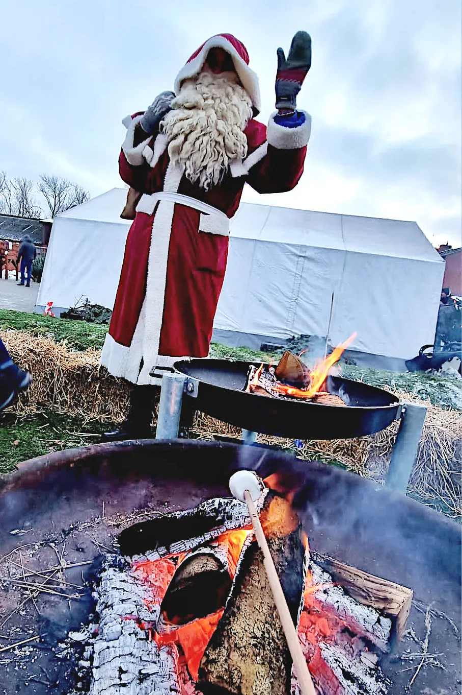
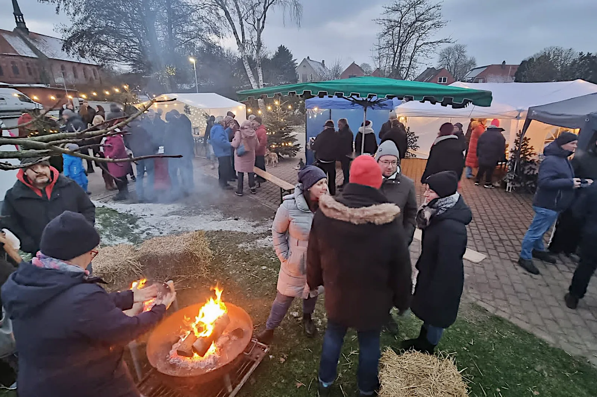
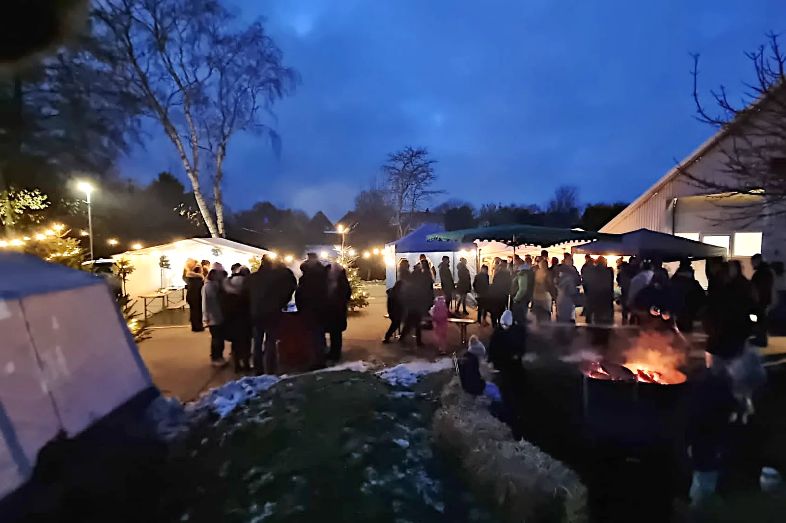

**Endlich wieder ein wenig Normalität, endlich wieder ein paar gemeinsame Stunden verbringen und vor allem: endlich wieder anderen eine kleine Freude bereiten!**

Es war für uns als Verein der WGW wirklich deprimierend, als wir uns 2020 und 2021 eingestehen mussten, dass wir - wohl oder übel - auf unseren Weihnachtsmarkt verzichten mussten. Corona hatte uns zu dieser Zeit fest im Griff und ließ es einfach nicht zu, gemeinsam die vorweihnachtliche Zeit, zumindest für ein paar Stunden, sorg- und bedenkenlos,  zu verbringen.

Unser Motto: „Wir gemeinsam für Witzwort!“  stellten wir hierbei für uns auf die Probe und in Frage, denn gerade in dieser Zeit galt es doch, sich solidarisch zu zeigen. Schließlich entschieden wir uns für den Verzicht des Weihnachtsmarktes, und beließen es beim alleinigen Tannenbaumverkauf, unter Wahrung entsprechender Auflagen - als unser aller Beitrag für die Gesundheit und zum Schutz für jeden hier im Dorf. Doch im vergangenen Jahr durfte und sollte dann auch endlich wieder alles anders werden.

Die Planungen lagen bereits fertig abgeschlossen griffbereit in der Schublade – alles stand in den Startlöchern und wir waren uns sicher: 2022 sollte es ein ganz besonderer Weihnachtsmarkt werden. Neben vielen schönen Sachen der letzten Jahre, hatten wir uns neue, tolle Dinge überlegt, mit denen wir Groß & Klein eine zusätzliche Freude bereiten wollten.

Hierbei konnte unser Verein allen Witzwortern, auf dem nunmehr schon 43. Weihnachtsmarkt der WGW,  neben dem alt bewerten Tannenbaum- und Glühweinverkauf, in diesem Jahr auch unsere neuen Ideen vorstellen: So erklang z.B. Weihnachtsmusik über den diesmal mit leuchtenden Tannenbäumen und Lichterketten geschmückten Weihnachtsmarkt. Unsere Kleinsten konnten in einem Kreis aus Strohballen, unentgeltlich Marshmallows über das Lagerfeuer brutzeln und anschließend bei einer warmen Tasse Kakao genüsslich verkosten. Neben einem Stand mit duftenden Waffeln und frischem Kaffee, hatte Viola Hauser aus Uelvesbüll ihre Produkte rund um ihr Unternehmen „Küstencookie“ ausgestellt und zum Verkauf angeboten.

Auch zum ersten Mal, wurden lecker zubereitete Futjes und andere Köstlichkeiten von den Kindern und Jugendlichen der Jugendfeuerwehr Roter Haubarg, mit Unterstützung des Fördervereins der hiesigen Feuerwehr, zubereitet und zum Verzehr angeboten. Auch wenn sich einige Wenige mit der Wartezeit darauf als unzufrieden erklärt und ihr Unverständnis darüber unangebracht an den Kindern ausgelassen hatten: eine insgesamt tolle Aktion - vielen Dank für euren Einsatz, ihr wart und seid super!

  

Neben dem Angebot des Pony-Reitens und der Kistenrollbahn brachte auch der Weihnachtsmann durch seine Anwesenheit und dem einen oder anderem Präsent, viele Kinderaugen zum Leuchten. Aber auch die Großen staunten nicht schlecht: fast alle Gewerbetreibende in und um Witzwort wollten sich nicht lumpen lassen und hatten für die Tombola hochwertige Preise gespendet,  herzlichen Dank dafür!

  

Eine insgesamt schöne und ausgelassene Stimmung umgab an diesem Nachmittag den Platz und viele waren bei bestem Wetter zusammengekommen, um mal wieder gemeinsam etwas Zeit zu verbringen und gemütlich über den Weihnachtsmarkt zu bummeln. Ehrlich gesagt hatten wir auf gute Beteiligung gehofft und zeigten uns schließlich von eurem regen Interesse und Andrang sehr dankbar und beeindruckt: zeitweise tummelten und klönten zeitgleich bis zu 90 Besucher bei vorweihnachtlichem Treiben auf dem Platz umher. Wirklich toll!

Noch eines in eigener Sache: wie bereits in den ganzen Jahren zuvor, gehen die Einnahmen aus den Verkäufen des Weihnachtsmarktes der WGW wieder ausschließlich in zahlreiche Aktionen unseres Dorfes über - und nicht, wie vielleicht angenommen, in die Geldbörsen der Betreiber. Wer uns kennt, weiß sehr wohl, wie oft und wie viel unser Verein für eine Vielzahl an gemeinnützigen Projekten und Vorhaben spendet - und zwar nicht nur für seine Mitglieder – sondern für alle in unserem Dorf!

Vielen Dank allen Besuchern, Helfern und großzügigen Spendern für jegliche Unterstützung! Wir freuen uns auf ein Wiedersehen in diesem Jahr und wünschen allen einen tollen Start in ein gesundes, neues Jahr!  

**WGW - Der Vorstand**
