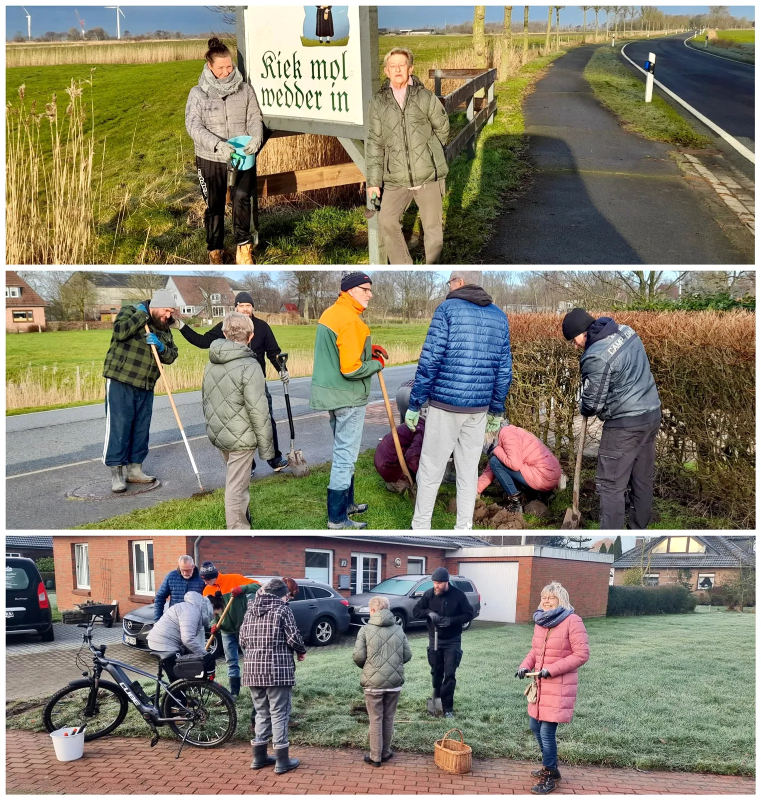

**Nachdem erstmals 2021 einer der 3 Ortseingänge Witzworts mit Frühlingsblumen verschönert wurde, kamen** **im Frühjahr** **nun erneut Vereinsmitglieder der WGW zusammen, um weitere Stellen in unserem Dorf zu verschönern.**

Auch in diesem Jahr hatte unser Verein wieder vom Hagebaumarkt in Husum rund 1.000 Blumenzwiebeln, bestehend aus Tulpen, Narzissen und Krokussen käuflich erwerben können, die jetzt galt, im Dorf zu platzieren, um damit hoffentlich vielen Dorfbewohnern eine kleine Freude zu bereiten.

So trafen sich am Vormittag des 04. Februars 10 unserer Mitglieder, gut gelaunt und mit vollem Elan, um dieses Vorhaben in die Tat umzusetzen.

Mit dem Start der WGW Pflanzaktion im Bereich des Ortseingangs, Ohlfelderweg/Kirchenweg 2021, hatten wir uns für dieses Jahr drei weitere Bereiche in unserer Gemeinde ausgesucht, an denen zukünftig Frühlingsblumen zu sehen sein werden. So konnten wir im Laufe des Vormittags, an den Ortseingängen, Dorfstraße und Süden, als auch im Bereich Margarete-Peters-Weg/Alte Festwiese, alle Zwiebeln unter die Erde bringen.   

Der Verein der WGW wird diese Aktion auch in den kommenden Jahren wiederholen, um auch noch weitere Flächen im Dorf zu verschönern. Wir bedanken uns bei allen fleißigen Helferinnen und Helfern und freuen uns auf das hoffentlich bald farbenfrohe Ergebnis.

**WGW - Der Verein**
