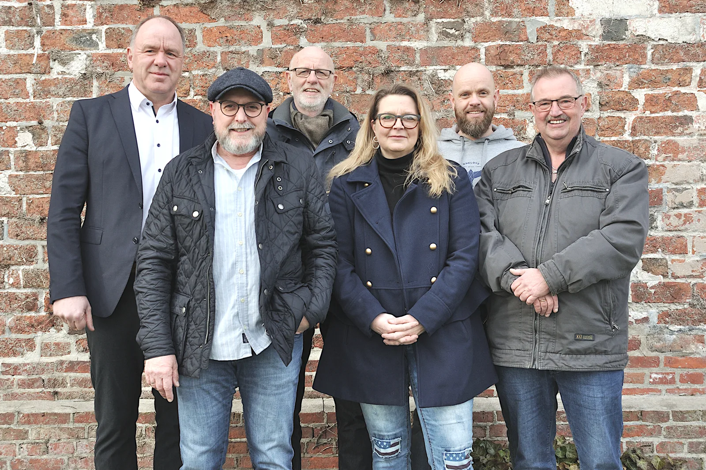

( v.l.n.r.: Jan Sievers, Andreas Löbbecke, Holger Drosdowski, Ariane Hennings, Hauke Mann, Uwe Röckendorf )

Im Rahmen der letzten Mitgliederversammlung Anfang Februar, kamen 31 der insgesamt 65 Mitglieder der WGW zusammen, um unter ihnen 11 Kandidatinnen und Kandidaten zu wählen, die zukünftig mit Sachverstand, konstruktiv und mit kritischem Blick auf das Notwendige und das Machbare, die Entwicklung und den Zusammenhalt der Gemeinde, auch in der kommenden Legislaturperiode, vorantreiben wollen.

Bereits bei den ersten Interessenbekundungen der sich zur Wahl stellenden Mitglieder, die sich künftig nicht nur bei den vielen Aktionen der WGW zur Förderung des Gemeinwohls, sondern auch politisch für Witzwort engagieren möchten, wurde ein guter Querschnitt aller im Dorf lebenden Bürgerinnen und Bürger repräsentiert.

Am Ende der Wahl waren sich alle einig: mit diesen Kandidatinnen und Kandidaten wollen wir uns für unser Dorf stark machen! Neben Jan Sievers, Holger Drosdowski und Hauke Mann, die bereits in der ablaufenden Legislaturperiode für die politischen Geschicke im Gemeinderat verantwortlich zeichneten, finden nun auch Ariane Hennings, Andreas Löbbecke und Uwe Röckendorf einen Platz auf der Liste der ersten 6 Direktkandidaten. Die verbleibenden 5 Listenplätze belegen mit Anja Jessen, Stefan Nöhring, Sascha Thomsen, Daniel Mittag und Wolfgang Kruse weitere motivierte Gemeindemitglieder.

Ganz nach dem Motto der WGW - **Wir GEMEINSAM für Witzwort** - sieht sich die Wählergemeinschaft mit dieser Liste sehr gut aufgestellt und in ihrem Bestreben bestärkt, auch in Zukunft die gemeindepolitischen Sachfragen und großen Herausforderungen dieser Zeit, gemeinsam und im Interesse aller, bestmöglich zu verhandeln.

**WGW - Der Verein**
