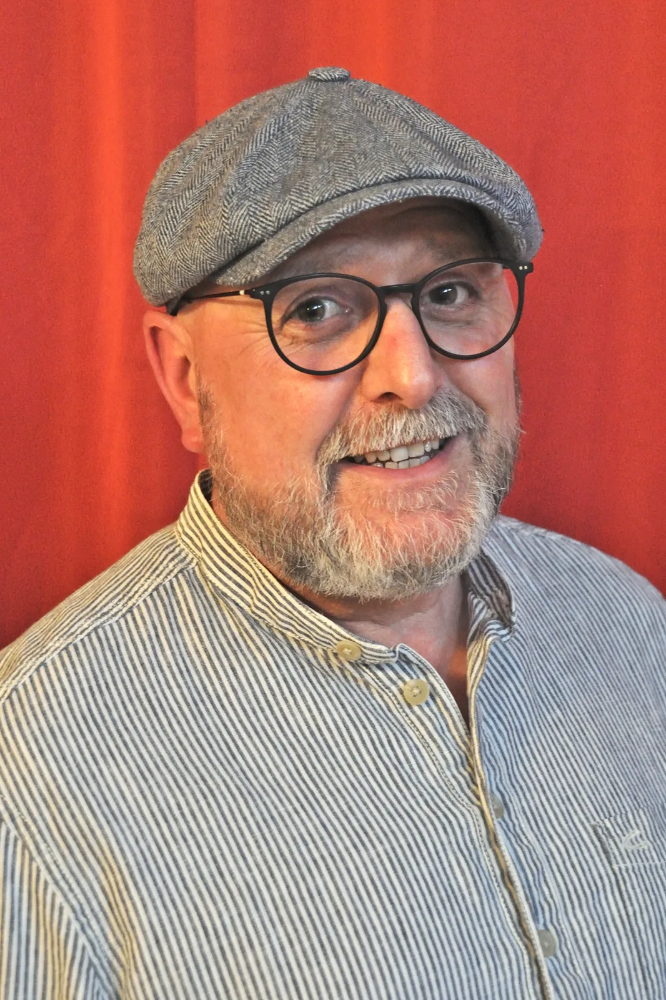

### Andreas Löbbecke

* * *

**Vereinsmitglied WGW,**

**Listenplatz Nr. 5**

Seit 2021 Mitglied in der WGW

#### Persönliches Profil

* * *

**Alter/Familienstand:**

54 Jahre, verheiratet, 2 Kinder

**Interessen:**

unsere beiden Hunde, Haus + Garten,

Reisen an den Küsten  

**Beruf:**

Messtechniker mit eigenem Büro

für Gebäude-Diagnostik

  

Liebe Witzworterinnen und Witzworter,

gern möchte ich mich Ihnen kurz vorstellen und Ihnen meine Motivation darlegen, künftig in der Gemeindevertretung mitwirken zu wollen. Als gebürtiger Westfale aus Hamm zog es mich mit meiner Frau 2008 in den Norden Deutschlands, um unserem Hobby, dem Kitebuggy-Fahren, am Strand von St. Peter-Ording häufiger nachgehen zu können. Nach einigen Jahren, die wir aus beruflichen Gründen zunächst in Heide lebten, sind wir nun seit 2017 in Witzwort verankert. Beruflich bin ich seit über 20 Jahren als Dienstleister im Bereich der Rohrbruch-Ortung und Gebäude-Diagnostik tätig und betreibe seit Ende 2011 ein Büro für Leckortung, dessen Sitz ich im Oktober 2022 von St. Peter-Ording nach Witzwort verlegte.

Bei vielen Veranstaltungen der WGW und des Fördervereins der Freiwilligen Feuerwehr Witzwort lernte ich viele Dorfbewohner\*innen kennen und schätzen; einige hatten ja „leider“ auch schon das berufliche Vergnügen im Rahmen eines Leitungs- oder Wasserschadens mit mir. So war ich z.B. auch teilweise mit der Abwicklung der Leitungswasserschäden im Dörpshuus (ehem. Tönnsen) betraut. Nach einer Eingewöhnungszeit kam ich auch als „Zugezogener“ im Dorfleben an und schätze neben der guten Infrastruktur den oft unkomplizierten und hilfsbereiten Umgang untereinander. Witzwort ist ein lebendiges und für mich sehr lebenswertes Dorf geworden. So war nach dem Beitritt zur WGW im letzten Jahr die Entscheidung nicht schwer, als ich von einigen Mitgliedern darauf angesprochen wurde, ob ich mir eine Mitarbeit in der Gemeindevertretung vorstellen kann.

Nachdem ich viele Sitzungen der Gemeindevertretung als Gast besuchte, bekam ich nach und nach ein deutlicheres Bild von der Dorfpolitik mit all ihren Herausforderungen und stellte fest, dass eine große Konstruktivität und Kreativität auf der einen Seite nicht selten einer relativ verhärteten und wenig konstruktiven Gegenseite gegenüber stand, die zudem keine Alternativen aufzeigte. Doch gerade im Bereich der Energieversorgung, der Schaffung von Wohnraum und dem Erhalt der Infrastruktur nebst Schule, Kindergarten und Lebensmittelversorgung gilt es, einen optimalen und zukunftssicheren Weg für alle zu finden. Wie wohl überall im Leben funktioniert aber ein „Miteinander“ deutlich besser als ein „Gegeneinander“.

Und so möchte auch ich meinen Hut in den Ring werfen und biete an, mich für Sie nach bestem Wissen und Gewissen zum Wohle der Dorfgemeinschaft für eine gute und gerechte Zukunftsgestaltung einzusetzen, um den Herausforderungen der aktuellen welt- und kommunalpolitischen und nicht zuletzt klimatischen Ereignisse gewachsen zu sein.

Ich hoffe, dass Sie alle von Ihrem Recht zur Wahl und somit zur Mitgestaltung Gebrauch machen und würde mich sehr freuen, wenn Sie die Wählergemeinschaft Witzwort und mich mit Ihrer Stimme unterstützen möchten.

Ich bedanke mich für die Aufmerksamkeit, wir sehen uns im Dorf!

Beste Grüße aus der Nachbarschaft
