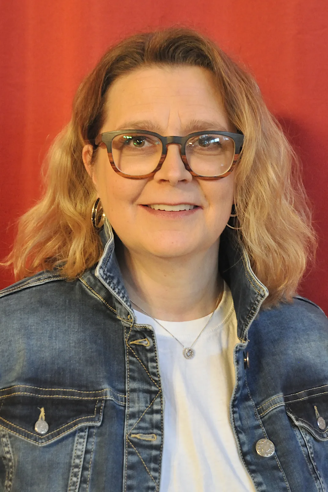

### Ariane Hennings

* * *

**Vereinsmitglied WGW,**

**Listenplatz Nr. 4**

Seit 2018 Mitglied in der WGW

#### Persönliches Profil

* * *

**Alter/Familienstand:**

46 Jahre, getrennt lebend, 2 Kinder

**Interessen:**

Ringreiten, Tanzen  

**Beruf:**

Gelernte Rechtsanwalts- u. Notariartsfachangestellte, derzeit Angestellte bei der Gemeinde Witzwort und dem  Schulverband Witzwort-Schwabstedt  

  

Liebe Witzworterinnen und Witzworter,

seit nunmehr fast 20 Jahren wohne ich nun in Witzwort und fühle mich sehr wohl hier. Meine Kinder konnten gut behütet hier in den Kindergarten gehen und danach die Grundschule im Dorf besuchen, wofür ich sehr dankbar bin. Während dieser Zeit habe ich mich gerne als Elternvertreterin engagiert und konnte so ein Stück weit KiTa und Schule mitgestalten.

Seit 2014 bin ich Jugendwartin in unserem Reiterverein, seit 2018 Mitglied in der WGW und seit Mitte 2020 kümmere ich mich um alles rund um unser schönes Dörpshuus. Ein Ort der Begegnung und wie wichtig Begegnungen sind, hat uns die Coronazeit gezeigt. Das Dörpshuus ist wieder voller Leben und ein Ort, wo Jung und Alt zusammenkommen können. Es bereitet mir sehr viel Freude, aktiv zu diesem Gemeinschaftsgefühl beizutragen, etwas für unser Dorf und seine Bewohner zu tun.

Aus diesem Grunde wage ich auch den Schritt, mich für Sie und Euch als Gemeindevertreterin zur kommenden Kommunalwahl aufstellen zu lassen. Zugegebenermaßen ein für mich mutiger Schritt, aber ich gehe ihn gerne, denn ich habe tolle Mitstreiter an meiner Seite und bin bereit, an den dann kommenden Aufgaben zu wachsen. Ich würde mich freuen, wenn Sie mir und damit auch der WGW, die Chance geben würden, mich in den kommenden Jahren aktiv für unsere Gemeinde, unser Witzwort, einzusetzen. Zukunftsorientiert und bodenständig, zum Wohle unseres Dorfes und seiner Bewohner.

Ihre
