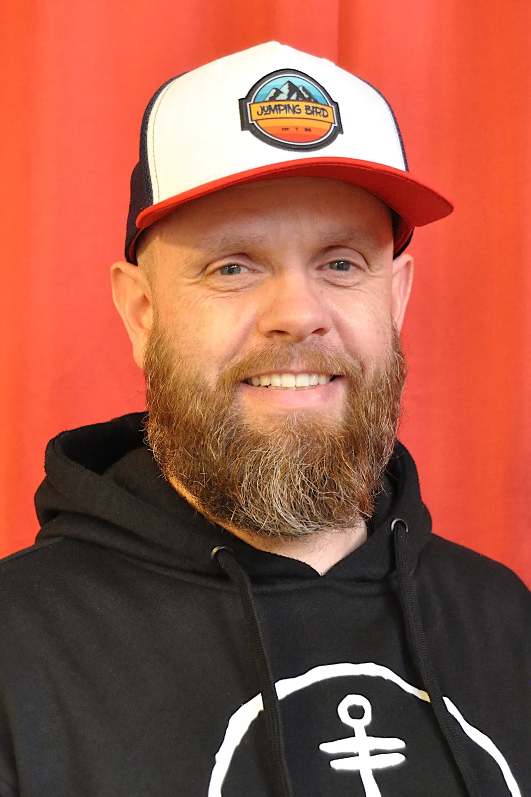

### Hauke Mann

* * *

**Gemeindevertreter WGW,**

**Sozialausschussvorsitzender,**

**Listenplatz Nr. 3**

Seit 2017 Mitglied in der WGW

#### Persönliches Profil

* * *

**Alter/Familienstand:**

45 Jahre, verheiratet, 2 Kinder

**Interessen:**

**Fotografie, Webdesign, Feuerwehr**

**Beruf:**

**Polizeibeamter**

  

Moin liebe Witzworterinnen und Witzworter,

gerne möchte ich mich und meine Beweggründe kurz vorstellen, warum ich mich erneut für Sie als Gemeindevertreter aufstellen lasse. Seit 2013 lebe ich zusammen mit meiner kleinen Familie in Witzwort. Wir wurden herzlich aufgenommen  und erhielten die Möglichkeit, uns aktiv in das Dorfleben mit einzubringen. So bin ich zum Beispiel seit 9 Jahren in unserer Freiwilligen Feuerwehr als Brandschutzerzieher für unsere Kleinsten im Kindergarten und in der Grundschule tätig und bringe den Kindern hierbei den Umgang mit dem Element Feuer bei.

Aber auch Planung, Aufbau und schließlich die Übergabe des Abenteuerspielplatzes 2019, an die Kinder im Dorf, haben meinen Freunden und mir damals im Rahmen unseres Projektes sehr viel Freude bereitet. Als kreativen Ausgleich zu meinem Beruf, verbringe ich einen Großteil meiner Freizeit mit meiner Familie und der Landschaftsfotografie und finde in der Gestaltung von Internetseiten, eine gelungene Abwechslung.  

Seit meinem Eintritt in die WGW 2017, liegt mir eine Sache besonders am Herzen: Ich will was bewegen, mich einmischen und gestalten, anstatt nur darüber zu reden, was andere könnten oder besser lassen sollten. Und das nicht alleine, sondern mit Ihnen gemeinsam – und das für jeden von uns. Seitdem widme ich mich, mittlerweile als 1. Vorsitzender der WGW der Möglichkeit, dass Miteinander in unserem Dorf aktiv voranzutreiben und beschäftige mich als Sozialausschussvorsitzender des Gemeinderats mit der Aufgabe, unser aller direktes Lebensunfeld im Sinne aller Dorfbewohner mitzugestalten. Hierbei ist unser aller Tun auf das Wohl der Gemeinde ausgerichtet.  

Das ist deswegen für mich so bedeutsam, weil sich unsere Zukunft hier vor Ort, unmittelbar vor unserer Haustür entscheiden lässt. Hier können wir uns als Gemeindevertretung arrangieren und mitbestimmen. Hier leben wir sozialen Zusammenhalt und engagieren uns für unser Dorf. Deswegen haben wir z.B. auch darüber entschieden, nicht nur unseren Vereinen mit dem Dörpshuus eine Heimat für ihre Veranstaltungen zu geben, sondern auch Trauergemeinden die Möglichkeit geschaffen, ihren Verstorbenen im Rahmen eines Beerdigungskaffees zu gedenken.

Im Rahmen des jährlichen Neujahrsempfangs kommt das Dorf zusammen, um engagierten und verdienten Bürgerinnen und Bürger zum "Bürger des Jahres" zu küren und durch den Eintrag in unser Goldenes Buch der Gemeinde entsprechend zu würdigen. Wir dürfen darüber entscheiden, wie Kinder, Jugendliche und Senioren bei Veranstaltungen beteiligt werden und sich begegnen. Und wie wir Orte des Zusammenkommens schaffen, damit unser Dorf weiterhin liebenswert und lebendig bleibt. Beispielhaft ist hierzu der in Kürze anstehende Bau eines öffentlichen Boule-Platzes am Rodelberg, als weitere Sportanlage in unserem Dorf zu nennen, bei der zukünftig Jung und Alt die Gelegenheit erhalten, über Wettkampf und Gemeinschaftssinn miteinander in den Kontakt zu treten.  

Unser Dorf geht uns alle an! Unabhängig von dem Ergebnis und Ausgang der diesjährigen Kommunalwahl, wünschen wir uns deshalb eine hohe Wahlbeteiligung. Sie haben die Wahl:  Bitte geben Sie der WGW und mir am 14. Mai Ihre Unterstützung, damit wir auch zukünftig, gemeinsam mit Ihnen, Witzwort positiv weiterentwickeln und aktiv mitgestalten können.

Ihr
