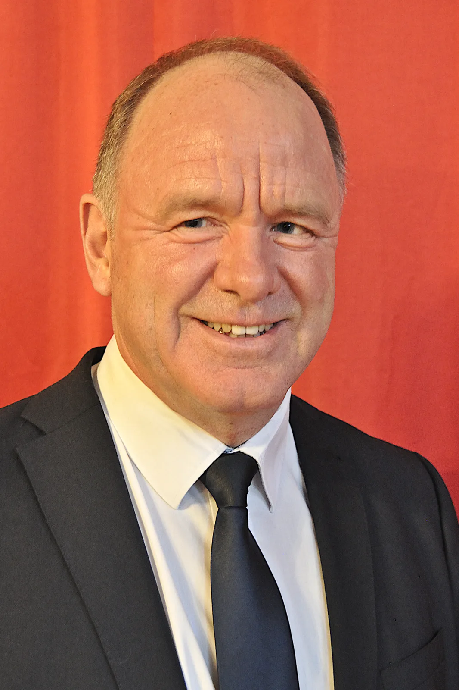

### Johann Sievers

* * *

**Bürgermeister WGW**

**Listenplatz Nr. 1**

Seit 2016 Mitglied in der WGW

#### Persönliches Profil

* * *

**Alter/Familienstand:**

57 Jahre, geschieden, 1 Kind

**Interessen:**

**Ringreiten,Tennis, Boßeln**

**Beruf:**

**Pensionierter Berufssoldat**

  

Liebe Witzworterinnen und Witzworter,  

auf diesem Wege möchte ich mich Ihnen gerne als Kandidat zur Kommunalwahl 2023 vorstellen und Ihnen meine Beweggründe verdeutlichen, warum ich erneut als Bürgermeister kandidiere. Doch zunächst einmal möchte ich mich bei Ihnen für das entgegengebrachte Vertrauen der letzten 5 Jahre bedanken.

Mit einem Rückblick auf die vergangene Legislaturperiode stelle ich fest, dass wir auf eine intensive Zeit zurückblicken können, in der wir - trotz Corona - wegweisende Entscheidungen getroffen haben, mit deren Umsetzung unser Dorf gut aufgestellt ist und auch zukünftig sein wird. Beispielhaft hierzu möchte ich vier wesentliche Punkte anbringen, für die wir uns eingesetzt haben:

-   Mit dem Anliegen, mehr Licht ins Dorf zu bekommen, konnten wir nun im Großteil unserer Gemeinde an vielen Stellen zusätzliche und energieeffiziente LED-Beleuchtungen installieren. Die Laternen in den noch nicht berücksichtigten Straßenzügen werden im Laufe dieses Jahres umgerüstet.

-   Durch die arbeitsreiche Umsetzung der beiden Neubaugebiete konnten wir viele neue Familien für unser Dorf gewinnen, die wir an dieser Stelle noch einmal willkommen heißen.  Hierdurch erhalten und stärken wir nicht nur unser lebendiges Dorf, sondern leisten unseren Beitrag für eine weiterhin gute Infrastruktur.

-   2019 konnte schließlich ein lang ersehnter Wunsch in die Tat umgesetzt werden: Seitdem erfreuen sich neben den Kindern der KiTa und Schule auch die Mitglieder des TSV über einen neuen, hochwertigen Sportplatz.

-   Unter der maßgeblichen Beteiligung der Feuerwehr sind die Bürger unserer Gemeinde durch die Inbetriebnahme eines Bürgertelefons sowie der Anschaffung eines Notstromaggregates für kommende Hilfeleistungen und Notlagen gewappnet.

Mit folgenden, bereits angestoßenen Maßnahmen, werden wir uns auch in der folgenden Legislaturperiode beschäftigen:

-   Der erforderliche Anbau des Feuerwehrgerätehauses, nebst zusätzlicher Parkfläche, wurde bereits im Februar diesen Jahres angestoßen. Damit wird z. B. die durch die Feuerwehrunfallkasse geforderte Umsetzung der Trennung von Privat- und kontaminierter Einsatzkleidung, als wesentlicher Punkt zur notwendigen Gesunderhaltung der Feuerwehrkameradinnen und Kameraden, sichergestellt. Die Fertigstellung des Anbaus wird voraussichtlich im Herbst erfolgen.

-   Des Weiteren beschäftigen wir uns nach wie vor mit dem erforderlichen Ausbau der Landesstraße 32 (Siethwende). An der Verbindungsstraße zwischen der B5 und unserem Dorf wird sich ein durchgängiger Fahrradweg im Abschnitt Bahnhof bis zu dem bereits vorhandenen Fahrradweg zur Meierei angliedern. Der Erhalt des bisherigen Allee-Charakters wird hierbei gewährleistet.

Darüber hinaus möchte ich die Gelegenheit nutzen, folgende, weitreichende Weiterentwicklung für unser Dorf noch einmal in Erinnerung zu rufen: Aufgrund zurückliegender, sinkender Schülerzahlen in unserem Schulverband (Witzwort, Uelvesbüll, Simonsberg) und die damit einhergehende Gefahr, die Eigenständigkeit unserer Grundschule zu verlieren, sah sich die Gemeinde mit der Herausforderung konfrontiert, den Schulstandort Witzwort sicherzustellen.

Als Schulverbandsvorsitzender war es mir daher eine Herzensangelegenheit, zusammen mit unserem Schulleiter, Herrn Jörg-Hinrich Meier, dieser drohenden Entwicklung entgegenzuwirken. Um hierbei eine nicht nur kurz- oder mittelfristige Lösung herbeizuführen, begaben wir uns deshalb in Gespräche mit der Grundschule Schwabstedt, die bereits auf der Suche nach einer „Mutterschule“ war.

Das übereinstimmende Ergebnis dieser Beratungen war die Fusion der beiden Schulstandorte Witzwort und Schwabstedt zur „Lütt Dörp School Witzwort – Schwabstedt“. Somit sind beide Standorte mit einer Gesamtschülerzahl von circa 140 Kindern langfristig gesichert und für die weitere Zukunft gut aufgestellt.

Erlauben Sie mir noch ein paar persönliche Worte: Meine eigene Motivation, die Weiterentwicklung unseres Dorfes auch fortan voranzubringen, sowie das uneingeschränkte Vertrauen in und seitens der WGW, hat mich überzeugt, mich nochmals als Bürgermeisterkandidat aufstellen zu lassen. Insbesondere die Gespräche und der unmittelbare Austausch mit Ihnen lag mir hierbei in den vergangenen Jahren besonders am Herzen. Hierdurch erhielt ich die Möglichkeit, Probleme, Wünsche und Anregungen aus erster Hand zu erfahren und mit in die Gemeindevertretung zu nehmen. Hieran möchte ich anknüpfen und freue mich auf gute Gespräche mit Ihnen.

Zu guter Letzt bitte ich an dieser Stelle um Ihr Vertrauen in meine Mitstreiter, um unseren bisher eingeschlagenen Weg weiter fortzuführen.

**Ihr**
