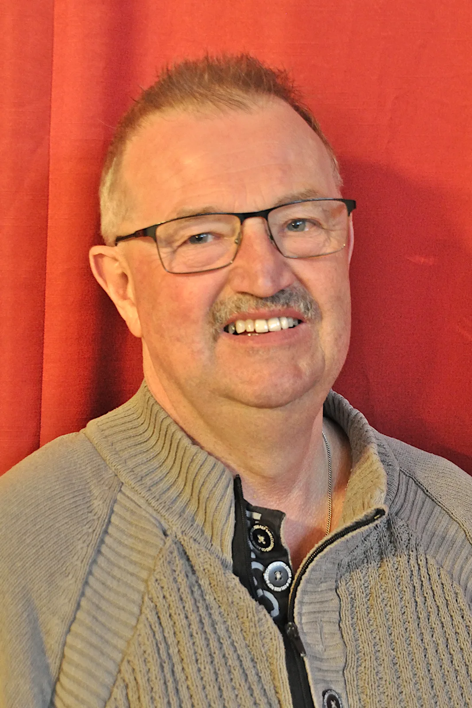

### Uwe Röckendorf

* * *

**Vereinsmitglied WGW,**

**Listenplatz Nr. 6**  

Seit 2018 Mitglied in der WGW

#### Persönliches Profil

* * *

**Alter/Familienstand:**

58 Jahre, verheiratet, 2 Kinder

**Interessen:**

Feuerwehr, Plattdeutsches Theater, Tennis, Motorradfahren, Reisen  

**Beruf:**

Kaufmann im Landhandel

  

Liebe Witzworterinnen und Witzworter,

gerne möchte ich mich mit einigen Worten bei Ihnen vorstellen. Als gebürtiger Witzworter, habe ich die ersten Jahre meines Lebens am Westerdeich verbracht und wohne jetzt seit über 30 Jahren mitten im schönen Witzwort. Ein Ortswechsel war für mich nie ein Thema, denn so ein vielfältiges, buntes und herzliches Dorfleben wie ich es in Witzwort vorfinde, ist denke ich einmalig.

Seit 1995 bin ich verheiratet und 1996 sowie 1999 kamen unsere Töchter zur Welt. Diese besuchten hier den Kindergarten und die Grundschule und wuchsen in einem sehr lebendigen, intakten Dorf mit vielen Vereinen und tollen Freizeitangeboten auf. Dafür, dass dieses auch anderen Familien und Kindern möglich ist, möchte ich mich unter anderem gerne einsetzen.

Seit über 30 Jahren bin ich aktives Mitglied der FF Witzwort, davon auch 20 Jahre als Atemschutzgerätewart. Ein weiterer Wunsch meinerseits ist es, den Menschen in unserer Gemeinde ein wenig Spaß und Ablenkung nach den vergangenen, doch recht harten und anstrengenden Jahren, durch meine über 25 jährige Mitgliedschaft in der Theatergruppe Witzwort, zu bereiten.

Zu meinen Hobbys gehört das Tennisspielen hier im Witzworter Tennisclub und Touren mit dem Motorrad durch die nähere Umgebung. Beruflich bin ich im Landhandel tätig. Nach meiner Ausbildung zum Groß und Außenhandelskaufmann blieb ich im selben Betrieb, dieses nun schon seit über 40 Jahren im Vertrieb.

Die immer auf das Wohl der Gemeinde ausgerichtete Arbeit der WGW hat in mir den Wunsch aufkommen lassen, mich mit Rat und Tat einzubringen und aktiv für ein positives und zielführendes Miteinander in unserem großartigen Dorf zu sorgen. Somit würde ich mich über Ihre Stimme am 14.05.2023 sehr freuen.

„Motivation ist, Dinge zu tun, die uns wichtig sind, zusammen mit und für Menschen, die uns wichtig sind.“

Ihr
