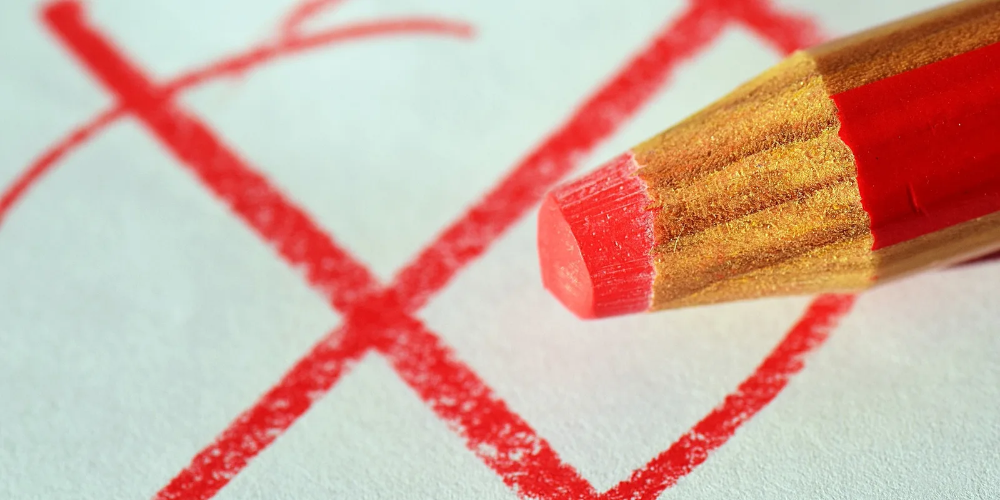
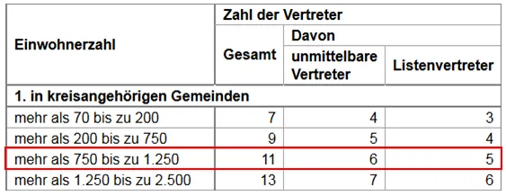
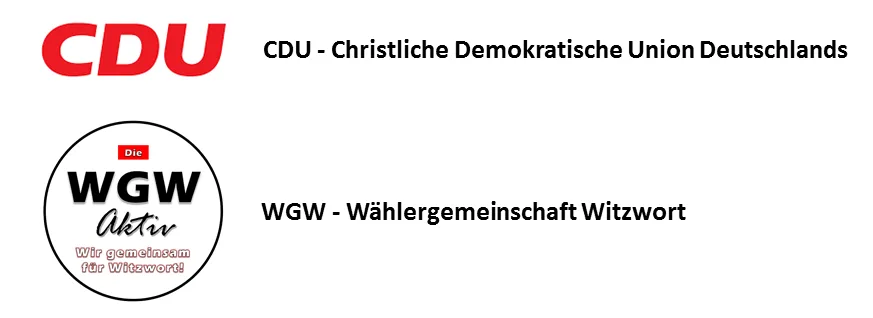
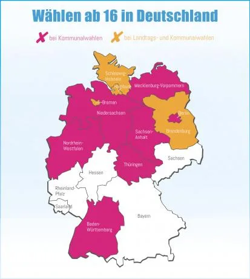
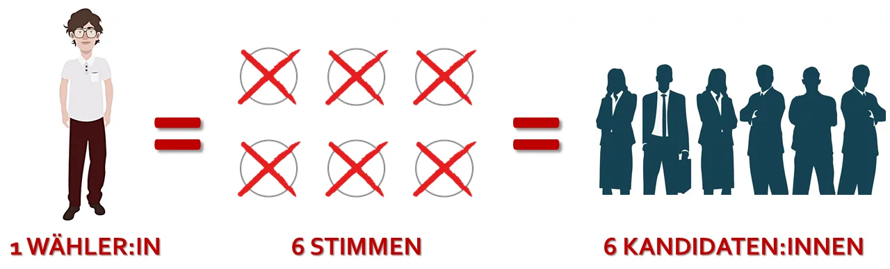

**WAHL-INFO FÜR UNSERE JUNG-/NEUWÄHLER**

_Quelle: pixabay.com_

**Am 14.05.2023 findet die Kommunalwahl in Schleswig-Holstein statt. Auch die Witzworter Bürgerinnen und Bürger werden aufgerufen, zwischen 08:00 - 18:00 Uhr, ihre Gemeindevertreter\*innen zu wählen.**

**Seit der Kommunalwahl im Jahr 2013, dürfen auch unsere 16-Jährigen mitentscheiden und  ihre Vertreter:in selbst wählen. Aber wie wird gewählt und wer kann dabei eigentlich wen wählen und warum? Diese Fragen versuchen wir an dieser Stelle kurz und knapp zu erklären und noch einmal in Erinnerung zu rufen.**

#### **Das Wahlsystem**

Sämtliche Gemeindevertretungen in Schleswig-Holstein werden für einen Zeitraum von **5 Jahren** nach dem System der personalisierten Verhältniswahl gewählt. Die Wahlzeit der neu gewählten Gemeindevertretungen **beginnt am 1. Juni 2023 und endet am 31. Mai 2028.**

Die zu wählenden Gemeindevertreter\*innen erhalten ihre Stimmen der Wählerinnen und Wähler einerseits durch die Mehrheitswahl in den Wahlkreisen, andererseits durch die Verhältniswahl aus den Listen der Parteien und Wählergruppen.

**Was ist die Aufgabe der Gemeindevertreter\*innen?**

Die Gemeindevertreter\*innen regeln, zusammen mit den Verwaltungen, die Aufgaben vor Ort - also innerhalb von Witzwort. So entscheiden sie z.B., ob es Wohngebiete geben soll oder ob die Feuerwehr ein neues Einsatzfahrzeug bekommt. Sie beschließen, wo Schule und Kindergärten gebaut werden, wie der Nahverkehr organisiert werden kann und vieles andere mehr. 

#### **Wie viele Gemeindevertreter\*innen werden gewählt?**

Die Anzahl der Vertreter\*innen richtet sich nach der Einwohnerzahl des Wahlkreises. Witzwort hat ca. 1.100 Einwohner. Demnach werden für unsere Gemeinde insgesamt 11 Gemeindevertreter:innen gewählt ( siehe Tabelle ). Von diesen 11 Vertreter\*innen stehen jeweils 6 Kandidat\*innen pro Partei/Wählergruppe auf dem Stimmzettel zur Wahl.

**Wer stellt sich zur Wahl?**

Witzwort verfügt zurzeit noch über

insgesamt 3 Fraktionen:

-   1 x Partei
-   2 x Wählergemeinschaft

Zur Kommunalwahl 2023 treten

jedoch nur die **CDU** und die **WGW** an.

.

 **Wer darf wählen?**

Wahlberechtigt zur Wahl der Gemeindevertretung sind alle Deutschen, die am Wahltag den **16\. Geburtstag** hinter sich gelassen haben.

**_Nebenbei: Diese Regelung gibt es in Schleswig-Holstein bereits seit 2013. D__er Anteil der 16 und 17-jährigen Neuwähler\*innen liegt_  _je nach Region zwischen 1,5 und 3,5 Prozent der Wahlberechtigten._**

Quelle: http://www.machs-ab-16.de

  

**Wie viele Stimmen hat der/die Wähler\*in?**

Jeder/jede Witzworter Wähler\*in hat so viele Stimmen, wie unmittelbare Vertreter\*innen im Wahlkreis zu wählen sind. In Witzwort gibt es 6 unmittelbare Vertreter/Kandidaten\*innen. Das bedeutet, dass jeder/jede Wähler\*in insgesamt **6 Stimmen** hat, die er/sie vergeben darf. Allerdings darf **pro Kandidat\*in nur 1 Stimme** gegeben werden. Somit kann man insgesamt 6 Kandidaten\*innen wählen.

**Aber Achtung: Man darf die 6 Stimmen zwar beliebig verteilen, hierbei aber nicht mehr als 6 Stimmen insgesamt, da der Stimmzettel ansonsten ungültig ist!**

**Kann der/die Bürgermeister:in direkt gewählt werden?**

Nein! Bei der Kommunalwahl in Witzwort wählen die Bürgerinnen und Bürger die Gemeindevertreter aus den verschiedenen Fraktionen. Die dann gewählten Gemeindevertreter:innen wählen daraufhin den/die Bürgermeister:in.  

Das bedeutet, dass die Fraktion, die im Rahmen der Kommunalwahl 2018 die Mehrheit an Gemeindevertretern:innen stellt,  somit auch  den/die Bürgermeister:in wählt.

**_Nebenbei: Werden alle 6 Kandidaten:innen der WGW gewählt, können diese gewählten Gemeindevertreter:innen auch den/die Bürgermeister:in wählen. In diesem Fall wäre das, und das bereits zum 2. Mal - unser Bürgermeisterkandidat, Jan Sievers._**

**Warum sollte gewählt werden?**

Die Möglichkeit wählen zu gehen ist ein Recht und keine Pflicht. Es steht allen frei, sich dafür oder dagegen zu entscheiden. Gibt man seine Stimme einem/einer Kandidaten/Kandidatin, nimmt man unmittelbar am demokratischen Prozess teil. Jeder/e kann damit direkt auf die Politik in Witzwort Einfluss nehmen. Gerade Themen, die Jugendliche stark beschäftigen, fallen leider häufig dem Sparzwang zum Opfer.

Mit Ihrer Stimme können Sie ein Zeichen setzen, dich für Toleranz, Bildung, Umwelt und Nachhaltigkeit aussprechen. Keine Stimme ist unwichtig. Oft liegen nur ein paar Stimmen zwischen verschiedenen Kandidaten\*innen. Ihre Stimme kann also den Unterschied machen und etwas bewirken! Gehen Sie nicht zur Wahl, überlassen Sie die Entscheidungen anderen. Nur wenn Sie selbst aktiv werden, haben Sie eine Chance etwas zu ändern.

**Je mehr junge Menschen ihr Wahlrecht wahrnehmen, desto stärker werden ihre Themen, Wünsche und Forderungen von den Gemeindevertreter\*innen berücksichtigt.** Interessieren Sie sich für bestimmte Themen oder sollte Ihrer Meinung nach etwas verbessert werden? Dann beteiligen Sie sich an der Wahl am 14. Mai!
