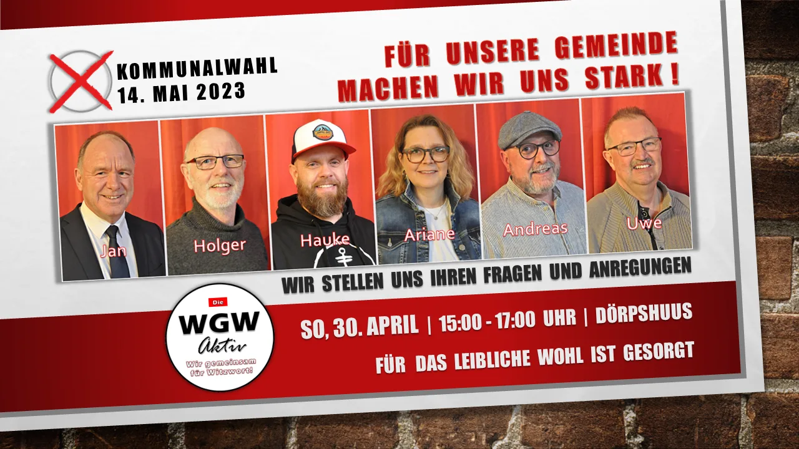
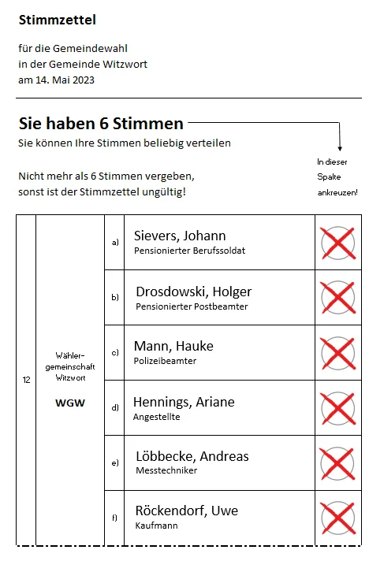

**EINLADUNG**

**Liebe Dorfgemeinschaft,**

am 14. Mai 2023 ist Kommunalwahl. Hierbei haben Sie die Möglichkeit, die zukünftigen Gemeindevertreter\*innen unseres Dorfes zu wählen. Diese gewählten Gemeindevertreter\*innen entscheiden dann, für die Dauer von 5 Jahren, zusammen mit dem/der neuen Bürgermeister\*in, über die politischen Geschehnisse in unserer Gemeinde.

Bereits am 01. November 2022 kam die WGW in ihrer Mitgliederversammlung zusammen, um darüber abzustimmen, welche ihrer Mitglieder die Wählerinnen und Wähler am 14. Mai zur Wahl haben. Heraus kamen 6 Direktkandidat\*innen, die stellvertretend für die WGW als Gemeindevertreter\*innen im Mai zur Wahl stehen (siehe Muster Stimmzettel).

**Nur dann, wenn es der WGW erneut gelingt, dass alle diese sechs Kandidat\*innen in den Gemeinderat gewählt werden, erhalten wir auch die Möglichkeit, unseren bisher eingeschlagenen Weg weiter fortzuführen.**

Bis dahin haben Sie hier die Möglichkeit, sich über die Portraits einen Eindruck über unsere Kandidat\*innen zu verschaffen und sich entsprechend über deren Person und Motivation zu informieren.

**Zu den Portraits:**

- [Johann Sievers](../2023-04-24-portrait-johann-sievers/)
- [Holger Drosdowski](../2023-04-24-portrait-holger-drosdowski/)
- [Hauke Mann](../2023-04-24-portrait-hauke-mann/)
- [Ariane Hennings](../2023-04-24-portrait-ariane-hennings/)
- [Andreas Löbbecke](../2023-04-24-portrait-andreas-loebbecke/)
- [Uwe Röckendorf](../2023-04-24-portrait-uwe-roeckendorf/)
Für alle unter Ihnen, die unsere Kandidat\*innen gerne einmal in einem persönlichen Dialog oder in einer offenen Gesprächsrunde kennenlernen möchten, bieten wir Ihnen die Möglichkeit, Ihre Fragen und Anregungen direkt an die Kandidat\*innen zu stellen.

Wir freuen uns auf ein Gespräch mit Ihnen und laden Sie hierzu am **30**. April**,** **15:00 - 17:00** **Uhr** - bei Kaffee und Kuchen - im **Dörpshuus** herzlich ein!
