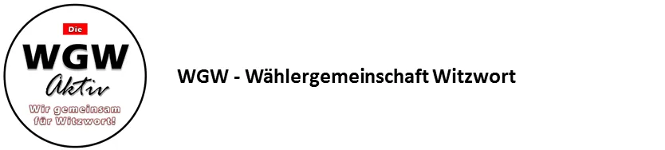
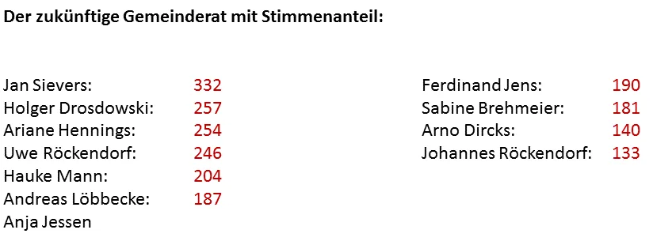

Die diesjährige Kommunalwahl liegt nun hinter uns. Am 14. Mai wurde der zukünftige Gemeinderat gewählt. Mit Hilfe Eurer/Ihrer Stimme ist es uns gemeinsam gelungen, nicht nur alle unsere 6 Direktkandidaten\*innen, sondern auch den Listenplatz Nr. 7, Anja Jessen, sicher und in überwältigender Stimmenanzahl, in den neuen Gemeinderat zu platzieren. Wir bedanken uns ganz herzlich bei all unseren Wähler\*innen und Unterstützern für das entgegengebrachte Vertrauen!

Dieser Wahlkampf hat uns noch mal wieder ein Stück zusammenwachsen lassen und deutlich gemacht, dass wir ein Team sind, dass das gleiche Ziel verfolgt – nämlich unser aller Tun auf das Wohl der Gemeinde auszurichten. Wir freuen uns sehr darüber, dass wir in den letzten Monaten viele neue Mitstreiter dazugewinnen konnten. So sind wir mittlerweile auf stolze 65 Mitglieder angewachsen, die unsere Gemeinde und den Verein fortan aktiv mitgestalten. Allen Helfern und Mitgliedern der WGW ein aufrichtiges Dankeschön für das Engagement und für die vielen Dialoge mit den Bürger\*innen in unserer Gemeinde.

Mit einem offenen Ohr für Sorgen, Nöte und Anregungen in unserer Gemeinde werden wir nach wie vor ausloten, was lösbar oder politisch umsetzbar ist. Für den bisher eingeschlagenen Weg benötigen wir auch weiterhin Eure/Ihre Unterstützung, um uns auch zukünftig gemeinsam für unsere Gemeinde stark machen zu können.

Die Wahlzeit der neu gewählten Gemeindevertretung beginnt am 1. Juni 2023. Es gibt viel zu tun, packen wir es an! Nachfolgend eine kleine Übersicht über Fakten und Ergebnisse dieser Wahl:

**Wahlberechtigte:**              861                           

**Wählerinnen / Wähler:**    513                      

**Wahlbeteiligung in %:**     59,6  

Stimmen:                 1.480

Prozent:                   60,8 %

Sitze:                        7  

Stimmen:                 955

Prozent:                   39,2 %

Sitze:                        4

  

Und für alle Statistiker unter uns, hier noch einmal die gesamten Zahlen - ganz offiziell:

[https://www.wahlen-sh.de/grw/gemeindewahlen\_gemeinde\_010545492161.html](https://www.wahlen-sh.de/grw/gemeindewahlen_gemeinde_010545492161.html)
