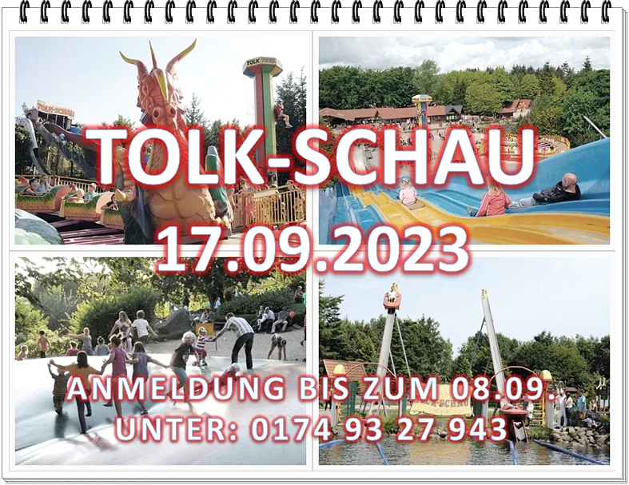

**Endlich ist es wieder soweit – es geht los!**

Die WGW lädt alle Witzworterinnen und Witzworter, egal ob groß oder klein, **am Sonntag, den** **17.09.2023** zur TOLK-Schau ein.

Wie immer, sind nicht nur Mitglieder der WGW - sondern **ALLE** **Dorfbewohner -** herzlich eingeladen. Zum Hintergrund: Die WGW zahlt aus dem Erlös ihres Tannenbaumverkaufs am Weihnachtsmarkt der WGW die Kosten für den Ausflug in den Erlebnispark (Busfahrt, 28 EUR Eintritt pro Person, Grillhütte und Verpflegung).

Nach der langen Corona-bedingten Pause wollen wir nun gemeinsam in Tolk wieder viel Spaß haben und gemeinsam eine tolle Zeit verbringen. Wie bereits in den vorangegangenen Jahren, haben wir auch diesmal eine Grillhütte gemietet und werden dort mittags den Grill anwerfen und zusammen essen.

**Abfahrt mit dem Bus ist um 09:00 Uhr** beim Witzworter Kirchspielplatz. Die Fahrtzeit beträgt ca. 1 Stunde. Die Rückfahrt nach Witzwort treten wir gegen 17.00 Uhr an.

Die Kosten belaufen sich auf **20 EUR pro Person**. Wir bitten um eine kleine Spende für das gemeinsame Buffet (z.B. Salat, Pizza-Brot, Saucen, etc.). Anmeldungen und Koordination der leckeren Mitbringsel bitte **bis zum 08. September** über Lena Thomsen: 0174 93 27 943.

**WIR FREUEN UNS AUF EUCH!**

**WGW - Der Verein**
