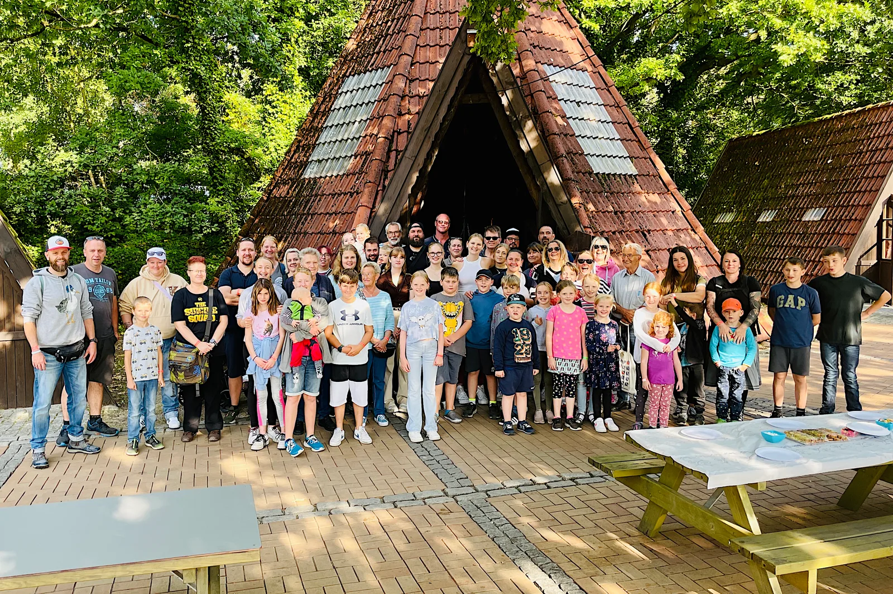

**WGW ON TOUR!**

Nachdem wir aufgrund der Corona Pandemie in den letzten 3 Jahren auf unseren alljährlichen Ausflug zur Tolk-Schau verzichten mussten, ging es in diesem Jahr nun endlich wieder los. Die Anfrage war enorm – mit so einer hohen Beteiligung hatten wir wirklich nicht gerechnet!

So trafen sich am Sonntagmorgen des 17. Septembers um 09:00 Uhr viele kleine und große Menschen am Kirchspielplatz in Witzwort,

um nach kurzer Besprechung und Bezahlen des Eigenanteils (20 EUR), mit dem eigens hierfür angemieteten Reisebus der Fa. Meisterreisen zur Tolk-Schau zu fahren.

Die WGW zahlt jedes Jahr aus dem Erlös des Tannenbaumverkaufs einen Anteil des Eintrittspreises, die Grillhütte, Wurst und Fleisch zum Grillen, die Getränke und ein Eis für all diejenigen, die sich zum Abschluss des Besuches noch einmal etwas "Süßes" gönnen wollen.

Nach pünktlichem Eintreffen in Tolk, zog unser heitere Gruppe dann geschlossen im Gänsemarsch und mit schwerem Gepäck zu der angemieteten Grillhütte, wo wir unser Lager aufschlugen, um von dort aus - und das bei hervorragenem Spätsommer-Wetter - in kleinen Gruppen und auf eigene loszuziehen, um den Park und seine tollen Attraktionen zu erkunden.

Viele Teilnehmer hatten sich dankenswerterweise bereit erklärt, leckere Salate, Pizzabrötchen und vielerlei mehr Leckereien zu spenden und mitzubringen, so dass um die Mittagszeit der Spielespaß für ein gemeinsames Essen kurz unterbrochen wurde.

Nach der Stärkung und einem kurzen Klönschnack ging es nach der Pause wieder voller Eifer in den Park. Unser „Camp“ stand nun durchgängig für Pausen und Getränkenachtanken zur Verfügung, bis es dann gegen 17:00 Uhr mit einem Eis in der Hand Richtung Ausgang ging.

Der jährliche Ausflug ist immer wieder ein harmonisches und nettes Miteinander. Ohne Zwänge und mit viel Spaß am Gemeinsamen. So auch in diesem Jahr: 57 gutgelaunte Witzworter:innen hatten schlussendlich den Tag im Freizeitpark gemeinsam verbracht.

Unabhängig, ob sie der WGW angehörten oder nicht. Denn dieses Event ist wie alle Aktionen der WGW - für ALLE Dorfbewohner! Unsere Schriftwartin, Lena, konnte sich nicht erinnern, ob jemals schon so viele Teilnehmer:innen, nach bereits jahrzehntelanger Tradition, gemeinsam die Zeit im Erlebnispark verbracht hatten.  

Bei dieser Gelegenheit wollen wir nicht versäumen, gerne schon einmal an den anstehenden WGW-Tannenbaumverkauf am 3. Advent zu erinnern. Auch dieses Event der WGW bringt viel Freude und gute Laune in unsere Dorfgemeinschaft. Und was am Ende dabei herauskommt, haben wir auch dieses Jahr wieder in Tolk sehen und erleben dürfen.

WGW - Der Vorstand
